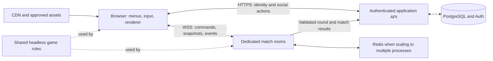

Current direction correction (October 31, 2026): the user requires the actual original game executing entirely in the browser, or a replica identical in every minute detail. The reconstruction-first recommendation, approximate small-pack acceptance and automatic fallback after a failed recompilation spike below are superseded. Read `docs/ORIGINAL_EXECUTION_ROUTE.md`; the existing implementation is research, not delivery of the corrected product.

November 1 route update: no local Xbox boot firmware is available. The [native-web feasibility checkpoint](docs/NATIVE_WEB_FEASIBILITY.md) records a bounded static-recompilation candidate and a real synthetic C/Wasm/browser probe. Next is one original initialization-function proof, with generated original code staying local. This does not select a final runtime, provide browser-local title conversion or satisfy any full-game/online acceptance gate below.

**Selected implementation direction (user confirmed November 1, 2026): pursue static recompilation of the original Xbox executable to WebAssembly, with compatible browser runtime services and the complete planned custom features.** Use this direction for implementation and milestone planning. Preserve original behavior and the browser-local/player-supplied content boundary. Emulator work remains supporting research. Runtime compatibility, fidelity, performance, networking and server authority still require proof. See D023 in `docs/DECISIONS.md`.

This development plan describes a faithful, browser-playable reconstruction of the original Xbox **Fuzion Frenzy**, with online play, flexible controls, friends, lobbies, and browser-specific quality-of-life improvements. Prepared October 31, 2026. The roadmap below includes historical preparation assumptions. The current offline Twisted System implementation and remaining fidelity gaps are audited in `docs/G2_ACCEPTANCE.md`.

The user selected **a small online minigame pack first, followed by expansion to the full original game**, and **desktop browsers with keyboard and gamepad first, followed by mobile touch support**. Those decisions govern the sequence below.

Later scope decisions: require player-supplied compatible game files, convert/import assets locally without upload or redistribution, make the source repository public, and target faithful original rules/game feel with modernized visuals mirroring or reusing existing local game assets. Read [player-supplied content](docs/PLAYER_SUPPLIED_CONTENT.md) and [scope/fidelity gates](docs/SCOPE_AND_FIDELITY.md); these supersede earlier tentative distribution assumptions. The first pack counts four-to-six selectable activities, including the Frenzy round explicitly; exact activities/character roster freeze at G4 after evidence and conversion/network proofs.

Setup update, October 31, 2026: REA is now connected and a fresh server reports Ghidra available. Ghidra 12.1.4, portable Java 21, and the matching Xbox loader are installed and tested. The game's actual XBE entry decompiled successfully through direct Ghidra; direct XBE support is not advertised by REA's Windows interface. See [the verified analysis setup](docs/ANALYSIS_SETUP.md). The original planning-pass evidence and unknowns below remain historical observations unless superseded by that setup record.

**1. Delivery target.** Reconstruct the original game's behavior in a web-native client, using targeted reverse engineering and measured reference play to establish fidelity. Release a four-to-six-minigame pack with the complete online/social/control experience, then expand through tracked content milestones. A full-game milestone requires catalog and mode parity; the first pack must be labeled as a partial release.

The original baseline is one to four players and six arenas. Xbox's listing advertises more than 45 minigames, while the Blitz retrospective describes 45 excluding the titular Frenzy round. The shipped copy's selectable games and variants will determine the exact parity inventory. [Xbox product listing](https://www.xbox.com/en-us/games/store/fuzion-frenzy/c2p985h1h42h), [Blitz retrospective](https://www.blitzgames.com/games/fuzionfrenzy)

The original manual establishes Tournament and Minigame Frenzy modes, practice, and tournaments of two, four, or six stages, with three minigames followed by an orb-based Frenzy round per zone. It identifies Dub, Samson, Geena, Zak, Naomi, and Jet, and the Coliseum, Downtown, Outlands, Military Zone, Power Station, and Waterfront zones. These are the reference scope, subject to validation against this particular copy. [Original Microsoft manual, mirrored PDF](https://manuals.plus/m/42d6143cf748d1807f7169ab332023ff44b65ad122b709e110a0ffcb51b7383c.pdf)

**2. Current evidence and limits.** The workspace was inspected before planning. It is not currently a Git repository and contains a single game archive, with no source tree, existing web app, or AGENTS.md found in the workspace or checked ancestor locations.

| Item | Observed evidence | Limit |
| --- | --- | --- |
| Input archive | `Fuzion Frenzy (USA).7z`, 540,303,986 bytes | Filename does not establish build identity or permissions |
| SHA-256 | `1B67B7224DE6264041F9A65B904D016D4AAF5FFC267870C1171D055AD4DDE776` | Digest identifies the inspected archive, not a verified release |
| Archive contents | 7-Zip lists `Fuzion Frenzy (USA).xiso.iso`, 2,084,569,088 bytes, and a 310-byte text file | ISO contents and executable metadata were not inspected |
| Application source | None present | Original source availability is unknown |
| REA tools | No REA MCP tools advertised; no installed `rea` command found | No decompilation or REA Evidence records were produced |
| REA diagnostic attempt | Pinned `rea-agents@6.7.0 doctor --client codex --json` could not fetch the package because npm registry DNS failed (`ENOTFOUND`) | Registration and engine readiness remain unverified; configuration was not changed |
| Runtime behavior | Not observed in this planning pass | Game rules, timings, file formats, and visual fidelity remain research tasks |

The local evidence above comes from ordinary filesystem, hashing, and 7-Zip tools. It is not REA Evidence. Public documents establish product scope; architectural choices and numerical budgets below are proposals, not observations of the original game.

Investigation status: **answered** for workspace contents, release/device priorities, and the proposed requirements-to-milestones plan; **partially answered** for original-game scope and analysis readiness; **unresolved** for exact disc build identity, complete shipped catalog/variants, numeric gameplay rules, asset formats, provider/XBE support, and original-content distribution permissions. The unresolved items have explicit research or release gates below.

**3. Scope and priorities.** Keep every requested capability in the first public pack, while limiting content volume. Add further minigames only after the foundation has demonstrated different mechanic families.

| Capability | First public pack | Full original-game milestone | Later enhancement |
| --- | --- | --- | --- |
| Content | Four to six verified games, including timing, contact, steering, and orb objectives | Every inventoried minigame and variant, all zones, characters, and reference rules | Additional original modes or content only as a separate scope |
| Modes | Practice, individual games, custom playlists, clearly labeled shortened tournament | Complete original Tournament and Minigame Frenzy progression | Daily challenges, optional custom rule presets |
| Players | One to four total seats; local, online, and mixed local/online; CPU fill | Fidelity tuning for all original player/team combinations and bot difficulties | Spectators if capacity permits |
| Controls | Remappable keyboard and gamepad; per-seat device assignment | Device/browser parity across the full catalog | Touch and mobile ergonomics |
| Social | Recoverable accounts, friends, requests, invite/join, privacy, block/report | Polish and reliability improvements | Optional richer community features |
| Lobbies | Create, discover, invite, codes, ready/start, owner handoff, rematch | Complete mode configuration | Larger parties or tournament brackets require a separate design |
| Browser UX | Fast start, reconnect, saved settings, quality controls, audio/fullscreen handling | Asset streaming and optimization for the larger catalog | Installable PWA and optional offline caching |
| Competition | Casual play, server-validated results | Stable full-catalog rules | Ranked ladders, public leaderboards, anti-smurfing, and voice chat are separate projects |

Four seats means four participants in a match, even if one browser owns several seats. The initial scope is an in-app friends list; importing Xbox friends or depending on Xbox Live services is not assumed.

**4. Implementation route.** Pursue static recompilation of the original XBE to WebAssembly. Retain original game routines and implement the compatible browser services and integration hooks required for the planned controls, online play, social features, tournament persistence and recovery. Recompilation is the selected development direction; an actual title-compatible runtime is not yet accepted.

| Route | Why examine it | Main unresolved work | Planning decision |
| --- | --- | --- | --- |
| Static recompilation of the XBE to a browser runtime | Preserve original instructions while exposing host integration hooks | Title coverage, browser-local code conversion, compatible Xbox services/graphics/audio, multiplayer hooks and authority | Selected route to pursue; advance through measured title/browser milestones |
| Web-native hand reconstruction | Earlier prototype/research | Exact behavioral parity would require separate proof | Not the selected implementation route; preserve existing work as research |
| Xbox emulator compiled for browsers | Reference execution and reusable runtime/renderer research | Browser/title performance and host integration remain unproved | Supporting research, not the primary product route |
| Remote emulator streamed to browsers | Separate architecture | Game execution would occur outside the browser | Excluded by the user's browser-only requirement |

xemu documents native Windows, macOS, and Linux operation; that establishes a potential reference environment, not a proven browser deployment. The xboxrecomp project describes native recompilation tooling, which does not establish this title's browser compatibility. Emscripten documents porting limitations that still need to be solved when targeting the browser. [xemu](https://xemu.app/), [xboxrecomp repository](https://github.com/sp00nznet/xboxrecomp), [Emscripten portability guidelines](https://emscripten.org/docs/porting/guidelines/portability_guidelines.html)

Proceed through bounded recompilation milestones. Next, translate one original initialization function using the existing analysis and verify its browser execution boundary with locally selected title-derived output. Then work toward an original controllable scene, a browser-local conversion/runtime path, and verified custom-feature integration including authority. Preserve concrete failures and unsupported behavior; report material blockers before proposing a route change. Do not automatically fall back to reconstruction or plain emulation after a failed probe. The full original-game and custom-feature acceptance requirements remain in force.

**5. Reference research and reverse engineering.** Use the supplied reverse-engineer-anything skill's evidence-first workflow. Answer explicit questions rather than attempting to recover the entire program before making a playable game.

The research checklist is: exact build identity; complete selectable content; rules and scoring; input semantics and timing; movement and collisions; hazards and randomness; cameras; bots; animation/audio cues; asset formats; tournament persistence; and differences between reference behavior and proposed browser improvements.

Proceed in this order:

1. Preserve the archive unchanged and record its digest. Before extraction, inspect free disk space and use an ignored local research directory; extraction needs at least the listed ISO size plus selected files and working space.
2. Materialize the XISO into that research directory, inventory its filesystem, and extract only necessary files initially. `xdvdfs` supports image listing, metadata, and selective copy-out; use a pinned reviewed tool build rather than assuming ordinary ISO tooling understands Xbox images. [xdvdfs maintainer documentation](https://github.com/antangelo/xdvdfs)
3. Identify and hash the main executable, other executables, resource containers, and configuration. Verify title/region/version metadata before naming this the reference build. Inspect signatures and bytes before classifying resource formats.
4. Restore usable REA access when native analysis is needed. Start with read-only connection diagnostics. The current failure is absent session tools plus a failed CLI package fetch; it is not evidence that a particular disassembler is missing. If configuration repair is needed later, prepare the skill's exact dry-run plan before making configuration changes.
5. Confirm the selected provider can load this Xbox XBE and preserve its virtual addresses, sections, and imports. Do not assume generic PE support implies XBE support. If a format-specific loader or another host is needed, document that requirement; a failed or unsupported load remains an unknown. Do not rename the binary and treat an invalid load as valid analysis.
6. Start from a small inventory and specific seeds: instruction text, minigame identifiers, round state, scoring tables, movement constants, asset references, and input dispatch. Follow focused references and functions. Preserve REA Evidence IDs, target digests, addresses/file ranges, coverage, and uncertainty. Recovered pseudocode is not original source.
7. Establish a reference runtime on original hardware or a compatible emulator, using the same verified copy. Record declared scenarios: start/practice/end, collisions, ties, elimination, orb banking/stealing, team variants, and tournament transitions. Static analysis cannot establish what happened at runtime.
8. Measure input-to-action delay, jump/duck windows, acceleration, turn response, collision response, round duration, camera framing, and animation cues. Record capture frame rate and emulator settings. Distinguish game behavior from capture or emulator timing artifacts.
9. Turn each established behavior into a written minigame specification and a reproducible test scenario. Continue independent implementation with placeholder assets when a visual/audio or binary question remains unresolved.
10. Export reusable findings and close analysis sessions after the investigation. A bounded failed search does not prove a mechanic or resource is absent.

Keep `research/` and extracted content out of source control and public builds. During implementation, create a finding ledger containing question, observation/inference/unknown, source or Evidence ID, artifact identity, confidence, search boundary, and next action. Each minigame gets an inventory row for zone, variant, controls, teams, scoring/ties, hazards, movement, camera, bots, assets, measured parameters, implementation state, and parity-test state.

**6. Player-supplied content and asset pipeline.** The user selected required local game-file import: each connected browser supplies compatible files and converts original assets locally. No ROMs, original asset packs, imported media, or game-code copies ship in the repository/CDN/server or transfer between peers. Use the originals as a local fidelity baseline and modernize presentation while retaining character/arena identity. Independently created placeholders support engineering until conversion is proved. This is a distribution decision, not blanket permission for branding, music, extraction or redistribution; the published fan-content rules do not establish authorization for this port. [Microsoft Game Content Usage Rules](https://www.xbox.com/en-us/developers/rules)

Build the pipeline around an asset manifest: source identity, permitted use, converter version, output hash, license/provenance, size, and dependencies. Classify models, texture encodings, skeletons, animations, sound, music, collision data, and level data from actual inspection. Their formats are currently unknown. Prove one character, one environment, and one sound/animation set before estimating conversion of the full catalog.

Use browser-friendly model/animation outputs such as glTF/GLB where appropriate, compressed textures only after compatibility tests, and an audio encoding/fallback strategy tested in target browsers. Keep collision geometry and gameplay dimensions independent of rendering meshes. Validate scale, axes, bind poses, looping, transparency, material response, and audio cue timing against references.

Load a small common shell and only the active/next minigame's content. Preload the next round while players view results; release prior scenes, GPU resources, and audio buffers. Exclude the disc image, extracted binaries, and unapproved assets from deployment artifacts. Use automated manifest checks to enforce that boundary.

Original asset decoding/preloading operates from the local import context, not a game-asset CDN. Prove the uncompressed XISO path, bounded worker memory, an animated character/arena/audio conversion, optional local cache/delete, and compatible-content readiness per browser before broad art work. Website loading targets exclude first local import. The dedicated server must not rely on clients uploading game assets; establish an independent rules/geometry path. Details and go/no-go criteria are in the newer scope documents.

**7. Proposed architecture.** Use a TypeScript monorepo with a headless gameplay core shared by the browser and dedicated match server. Keep rendering, UI, transport, persistence, and gameplay rules independently testable.

| Layer | Proposed choice | Responsibility |
| --- | --- | --- |
| Client build | TypeScript and Vite | Browser bundle, modules, content loading |
| 3D rendering | Babylon.js; WebGL2 initial target | Scene, camera, animation, materials, effects |
| Menus and social UI | React and semantic HTML/CSS outside the render loop | Navigation, lobby, friends, settings, accessible focus |
| Shared simulation | Pure TypeScript modules with explicit fixed steps | Movement, rules, collisions, bots, scoring, serializable state |
| Match service | Node.js and Colyseus, matching pinned client/server versions | Authoritative rooms, input processing, state/event delivery, reconnect |
| Identity and persistent data | Managed PostgreSQL/Auth, initially evaluate Supabase | Accounts, friends, blocks, preferences, summaries |
| Ephemeral coordination | Single-process state first; Redis when using multiple match processes | Presence, room allocation, cross-process messages |
| Delivery | CDN/object storage plus long-running game-server containers | Immutable client/assets and persistent WSS sessions |
| Quality and operations | Rule tests, browser automation, headless load clients, structured metrics | Correctness, browser flows, capacity, diagnosis |

Babylon provides WebGL and WebGPU implementations. Start with a tested WebGL2 rendering path and select the backend before constructing scenes; optional WebGPU is an optimization milestone. A backend switch may require scene/resource reconstruction, so do not promise seamless live fallback. [Babylon WebGPU documentation](https://doc.babylonjs.com/setup/support/webGPU)

Colyseus currently documents fixed-timestep authoritative input and client prediction/reconciliation. Pin the chosen release after proving its APIs, including multiple local seats per connection, instead of assuming older tutorial code is compatible. [Server input and fixed timestep](https://docs.colyseus.io/netcode/server-input), [Client prediction and reconciliation](https://docs.colyseus.io/netcode/client-prediction)

Keep browser packages free of privileged credentials. Persistent database operations do not belong in the simulation tick. A static frontend host alone is insufficient for the dedicated match service; select hosting that supports long-lived WebSocket connections and predictable game-loop CPU time.

Suggested future repository boundaries are `apps/web`, `apps/game-server`, `packages/sim`, `packages/protocol`, `packages/input`, `packages/content-manifest`, `tools/asset-pipeline`, `tests/reference`, and `docs/research`. Keep infrastructure small initially; introduce separate services only when their responsibilities or load require them.

**8. Game framework and fidelity.** Define the first minigames against a stable lifecycle: load, instructions, practice, ready, countdown, active round, resolution, results, and next round. The server owns transitions, timestamps, winners, scores, random seeds, and tournament state. Round identifiers prevent stale input from affecting a later round.

Each minigame module declares its ID, rules/content versions, supported seats/teams, action bindings, state serialization, fixed-step update, scoring, completion conditions, bot policy, and content dependencies. A separate presentation adapter maps state and sequenced events to animations, sound, effects, and camera behavior. Render frames cannot advance rules or award points.

Use explicit simulation time, seeded randomness, stable ordering, and recorded inputs. Start with simple purpose-built kinematic collision and movement where they match the game. Test any physics engine on the server and client before expanding its use. Shared code and fixed ticks alone do not establish bitwise determinism; use authoritative snapshots and correction. Defer full rollback/lockstep until measured need and determinism tests justify it. [Colyseus determinism guidance](https://docs.colyseus.io/netcode/determinism)

Treat music/pattern games as another expansion gate: establish the original sequence and button rules, whether scoring depends on beat-relative windows, and how audio/visual cues align. Test device output latency, input calibration where appropriate, and online fairness before releasing that family. A jump/duck timing slice does not prove audio synchronization, and new timing requirements must not be invented if the reference does not have them.

Keep original rules and optional modern rule changes separate. Accessibility/display preferences can apply broadly; a timing assist, altered scoring, or altered collision rule needs an explicit lobby ruleset and consistent application to all seats. Do not quietly change gameplay in a fidelity mode.

Build CPU players through the same input-command boundary as humans. For each game, document what a bot can perceive and its reaction delay/error model. Ship basic useful bot fill in the first pack; reproduce original difficulty behavior progressively as evidence becomes available. Offline local play uses the same authority interface inside the browser and works without an account.

**9. First playable and mechanic validation.** Start with a candidate timing game such as **Twisted System**, after verifying its identity, instruction screen, controls, and scoring against the supplied copy. It is a useful responsiveness test, but cannot validate contact-heavy or vehicle networking by itself.

Before freezing the framework, also build a contact/knockback candidate such as **Sumo**, a steering candidate such as **Jetboat Sprint**, and the Frenzy orb round. Names and detailed mechanics of these candidates must be checked in the actual inventory; they are proposed scope selections, not findings from this archive.

| Mechanic | Questions the slice must answer | Required proof |
| --- | --- | --- |
| Timed hazards | Can jump/duck actions feel immediate while elimination stays fair? | Reference timing cases; four-client agreement under latency |
| Contact and knockback | Do prediction and correction remain understandable during collisions? | Simultaneous contacts, boundaries, knockback and tie cases |
| Steering and boost | Do analog and digital controls both work, including reconciliation? | Steering, acceleration, turning, boost, reset and finish cases |
| Orb objectives | Can contested pickup, carrying, hits, stealing, deposit, and score resolve once? | Concurrent interaction tests and tournament-score audit |

Select the remaining first-pack games to reuse validated systems while adding variety. Inventory and practice UI should show only playable content, with a separate clear roadmap for unfinished content. Do not expose broken selectable entries merely to suggest full-game coverage.

**10. Online simulation and transport.** Start with dedicated server authority over WSS. The browser sends commands, predicts selected local responses, and renders remote state using interpolation. The server decides collisions, pickups, damage, elimination, scoring, and round outcomes.

Use provisional 60 Hz simulation, 20-30 Hz state delivery, and one fixed-step input frame per connected browser per simulation step for the selected prediction path. Measure these values during the slices and revise them per mechanic and bandwidth. Prove a per-connection frame representing every owned seat, with composite prediction, rather than alternating individual seat messages through a single session's input queue. Preserve one-frame/one-step acknowledgment semantics before adding any safe batching or transport optimization. Adapt the wire format to the selected library's actual schema constraints.

Each frame carries an input sequence and round epoch, with action edges/held actions and normalized analog values for its owned seats. The server validates ownership, ranges, rate, ordering, and acceptable timing windows. Client clocks and claimed outcomes are untrusted.

Maintain an acknowledged-input history to reconcile local prediction against authoritative state. Smooth small visual corrections; make significant elimination or ownership corrections explicit. Keep collision outcomes authoritative and record correction frequency/magnitude to find cases where movement prediction or remote interpolation is misleading. Bound prediction history, message size, input queues, and catch-up work to avoid runaway memory or simulation stalls.

Timing-critical actions need measured clock synchronization and a documented acceptance policy. Prototype a small bounded input buffer or bounded server-side historical validation only if tests show it is needed. Do not permit arbitrary client backdating, nor assume rollback for every object is necessary. Test fairness between low- and high-latency clients rather than relying on average ping.

Deliver one-shot events with round-scoped sequence IDs so effects and rewards are not duplicated or lost through snapshot coalescing. Make round and match result writes idempotent using unique server-generated IDs. State synchronization retains state changes rather than a complete event history, so event semantics must be explicit. [Colyseus state synchronization](https://docs.colyseus.io/state)

WSS is the initial transport choice, with reliable ordered delivery as a latency tradeoff to measure under loss. Monitor browser outgoing queue size. Preserve fixed-step input frames and discrete action edges; discard obsolete continuous presentation/status updates only where their semantics allow it. WebSocket has no automatic backpressure; application queues need bounds. If measured stalls fail the latency gate, evaluate WebTransport or WebRTC in a bounded spike, including signaling/connectivity, deployment, compatibility, and fallback costs. [WebSocket API](https://developer.mozilla.org/en-US/docs/Web/API/WebSockets_API), [WebSocket bufferedAmount](https://developer.mozilla.org/en-US/docs/Web/API/WebSocket/bufferedAmount), [WebTransport](https://developer.mozilla.org/en-US/docs/Web/API/WebTransport), [WebRTC data channels](https://developer.mozilla.org/en-US/docs/Web/API/RTCDataChannel)

**11. Lobby, party, and reconnect behavior.** Model a lobby separately from its match. A lobby owner configures the party; a dedicated server hosts the simulation. Separate account identity, connection identity, local profile, and player seat identity from the beginning.

The main flow is: Play -> guest or account -> assign local devices/seats -> create or join -> choose character/playlist -> ready -> preload -> countdown -> round -> results -> rematch/next round -> persistent lobby. Provide a direct invite path that returns to the invited lobby after sign-in or initial onboarding.

Lobby requirements:

- Public, friends-only, unlisted, and private visibility, enforced by the server on every join and reconnect.
- Browse/filter by region, estimated ping, available player seats, mode, playable content, and privacy. Keep private-room details out of public discovery.
- Share links, expiring invitations, and short join codes with rate limits. A code locates or grants scoped access to a room; it is not a general authentication token.
- Atomic, expiring seat reservations for all requested local seats. Test two browsers racing for the final seat and a two-seat request when only one seat remains.
- Owner controls for playlist, bots, rules, privacy, start, kick, and transfer. Invalidate ready states when material settings change.
- An asset-ready and compatible-version barrier before countdown. Define timeouts and a visible recovery path for failed downloads.
- Late arrival can wait for the next round; do not insert a player into an active scored round. Preserve a party and devices across rematches.
- Transfer lobby ownership to a suitable connected account if the owner leaves. This changes permissions, not game authority.

For transient disconnects, neutralize input immediately and reserve the player's seats for an initial 30-second reconnect window. Authenticate reconnection, resynchronize complete current state, and clearly show the reservation countdown. A neutral/frozen or bot takeover policy must be explicit per mode; reconnecting cannot erase an elimination or duplicate a score. Refresh recovery tokens should be short-lived, scoped, and excluded from logs. Colyseus provides reconnection primitives that must be integrated with these product rules. [Colyseus reconnection](https://docs.colyseus.io/room/reconnection)

A game-server crash is a different failure. For the first release, restore persisted tournament progress through the last committed round, mark an interrupted/uncommitted round void, and offer to recreate a lobby; never invent an outcome. Atomically persist the result and complete post-round tournament checkpoint: roster, scores/orb balances, stage/playlist position, rules/content versions, and required random state. Acknowledge the round as durable only after that transaction succeeds. Test interrupted writes and recovery from the committed boundary. Mid-round recovery from durable checkpoints is a later cost/benefit decision. Reconnection alone does not restore a dead process.

**12. Accounts, friends, and application data.** Permit instant guest play, with a recoverable account encouraged before durable social features. Evaluate Supabase Auth/PostgreSQL for anonymous identity followed by email/OAuth linking. Anonymous identity can be lost when local credentials are cleared, so explain the limit and preserve the guest-to-account transition without creating duplicate profiles. Keep offline play independent from the online identity provider. [Supabase anonymous sign-ins](https://supabase.com/docs/guides/auth/auth-anonymous)

Provide friend codes or exact handles, requests, accept/decline/cancel, removal, presence, invite, and authorized join. Presence defaults to friends-only and respects an offline/privacy setting. Reject requests, invites, and joins when either side has blocked the other. Define which lobby membership authorizes seeing presence, and clear stale online status with heartbeat expiry.

| Durable entity | Main constraints |
| --- | --- |
| Profiles | Stable internal ID; display names distinct from identity; validated and escaped text |
| Friend requests | One pending relationship per pair/direction policy; transactional state transitions |
| Friendships | Unique canonical user pair; acceptance required; remove does not reveal hidden presence |
| Blocks | Directional ownership; enforced across discovery, requests, invites, and joining |
| Preferences | Versioned per-account settings; optional local-only device calibration |
| Invites | Sender, recipient/scope, room, expiry, use/revocation state |
| Tournament/round summaries | Authoritative match/round IDs; unique result writes; recoverable completed-round progress |
| Reports | Reporter, target/event context, minimal retention, restricted moderator access |

Presence, typing/emote state, active seats, and frame state are ephemeral. Do not write them to PostgreSQL each tick. Use server-side transactions and authorization checks, plus row-level policies wherever the database is exposed to clients. Never ship privileged service keys, and allow only the match service to write verified outcomes. [Supabase row-level security](https://supabase.com/docs/guides/database/postgres/row-level-security)

Start with preset lobby messages/emotes and block/report tools. Free-form chat and voice need a separate moderation, privacy, and infrastructure scope. Add account export/deletion, data-retention rules, and operational access controls before a public social launch.

**13. Flexible controls.** Route all devices through a semantic action layer, then through per-seat commands. The same gameplay actions should work from keyboard, controller, and later touch. Separate menu navigation, gameplay actions, and text entry to avoid accidental input capture.

For the first release, provide remapping, conflict detection, reset, controller dead zones, axis inversion and sensitivity where relevant, per-game prompts, and saved profiles. Support keyboard plus controllers together and multiple controllers, with explicit ownership/reassignment. Start with one keyboard player as the reliable default; offer two shared-keyboard players after an onboarding rollover/ghosting test. Never promise that a physical keyboard can register arbitrary four-player combinations.

Use a press-to-join controller flow, standard mapping when available, and a manual mapping fallback. Identify devices carefully across reconnects rather than treating a temporary gamepad index as a permanent profile. Display prompts matching the actual binding, with neutral button labels when the controller family is unknown. Make vibration optional and capability-dependent. Browser gamepad exposure can require interaction while the page is visible, which onboarding must handle. [Gamepad API guide](https://developer.mozilla.org/en-US/docs/Web/API/Gamepad_API/Using_the_Gamepad_API)

Clear held input on blur, visibility loss, device disconnect, remapping, and round transitions. Detect stale input server-side too. Browser tabs may throttle timers or stop animation callbacks when hidden; online authority therefore stays on the server, with visible AFK/rejoin behavior. Offline local play may pause. [Page Visibility API](https://developer.mozilla.org/en-US/docs/Web/API/Page_Visibility_API)

For keyboard layouts, separate physical key positions from displayed labels and allow full rebinding. Avoid browser-reserved shortcuts and prevent scrolling only while gameplay owns the relevant keys. [KeyboardEvent.code](https://developer.mozilla.org/en-US/docs/Web/API/KeyboardEvent/code)

In the later mobile phase, add adjustable virtual stick/buttons, left/right-handed layouts, multitouch, safe areas, pointer capture/cancel handling, and orientation guidance. Prove simultaneous movement plus two actions on physical phones, not only desktop emulation. Do not present desktop controls on a phone and call that mobile support. [Pointer events](https://developer.mozilla.org/en-US/docs/Web/API/Pointer_events)

**14. Browser quality of life and accessibility.** Make the first session work without instructions from outside the game: capability check, explicit Play interaction, local seat/device setup, readable controls, optional practice, and a clear return/rematch path.

The Play interaction should unlock audio and handle a denied start with an explicit retry. Provide separate music/effects levels, mute, optional rumble, fullscreen with a normal windowed fallback, render scale, quality presets, FPS cap, reduced motion, reduced flashes, camera shake controls, and text size. [Browser autoplay behavior](https://developer.mozilla.org/en-US/docs/Web/Media/Guides/Autoplay)

Use labels/icons as well as player colors; keep timers, hazards, prompts, and results legible. Menus need keyboard/controller navigation, visible focus, semantic labels, and screen-reader-readable instructions/results. Gameplay accessibility needs real playtesting; accessible menus alone do not establish that the entire game is accessible.

Display region/ping and connection quality, download progress and retry, reconnect countdown, actionable errors, and a diagnostics view with a copyable session ID that excludes secrets. Preserve preferences and device assignment across refresh when safe. Handle GPU context loss with scene recovery or a clear reload-and-rejoin path, and test browser storage denial/quota limits.

An installable PWA and optional offline minigame cache can follow stable desktop delivery. Cache by content/build version, surface download size and a clear-cache control, and apply updates between sessions or rounds, never halfway through a match. Service-worker caching must not silently mix protocol/content versions.

**15. Delivery sequence and estimated effort.** These are planning ranges for roughly two to three engineers, one artist/technical artist, and part-time QA, with overlapping art/reference work. They are not fixed-date promises. Original asset availability, fidelity level, and unknown file formats can materially change the schedule. Re-estimate after the research gate and after three different mechanic slices.

| Phase | Estimated duration | Deliverable | Exit gate/dependency |
| --- | --- | --- | --- |
| 0. Reference and feasibility | 2-4 weeks | Build identity, content inventory, evidence ledger, asset/distribution decision, renderer/netcode spikes, route decision | A repeatable reference scenario; plausible content pipeline; key unknowns assigned; route chosen |
| 1. Foundations | 2-3 weeks | Repository/CI, shared simulation and protocol, basic renderer, menus, input/seats, local and headless authority adapters | Four local seats and four remote seats can load/count down/run/reset a test arena; offline rules do not depend on the server framework |
| 2. First game online | 3-5 weeks | Reference-backed timing game, bots, instructions/practice, basic private room and reconnect | Four browsers finish ten consecutive rounds with matching outcomes; input/focus behavior passes |
| 3. Mechanic coverage | 4-6 weeks | Contact game, steering game, Frenzy objective system and shortened tournament | Contact, analog steering, disputed pickups and score persistence meet fidelity/network gates; framework revision complete |
| 4. Complete online alpha | 5-7 weeks | Accounts/friends, full lobby permissions, mixed local/online, invites, rematches, privacy, block/report, crash policy | End-to-end requirements pass across browsers and two real networks; social authorization tests pass |
| 5. First public pack | 4-6 weeks | Four to six polished games, usable art/audio, browser UX, performance and capacity hardening, runbooks | Rights/content gate, release acceptance matrix, load/soak, recovery, and staged rollout gates pass |
| 6. Full-game expansion | 30-60+ additional weeks | Remaining catalog, variants, characters/zones, original modes, bot and visual/audio fidelity | Complete inventory and parity criteria; no required row silently omitted |
| 7. Mobile and extended QoL | 6-10+ weeks, sequenced after desktop stability | Touch, phone/tablet optimization, optional PWA/offline cache and further polish | Physical-device controls, performance, reconnect and accessibility testing pass |

Sequentially, the first online slice is about 7-12 weeks, and the first public pack about 20-31 weeks. Full parity is a roughly 12-24+ month effort under these staffing assumptions. A solo or part-time effort should be budgeted as a substantially longer, likely multi-year project, rather than applying the same calendar to fewer people.

Mobile can begin after the desktop pack and run alongside catalog expansion if additional capacity is available; it need not wait for full-game parity. With the same staff, that parallel work increases the full-catalog calendar and must be reflected in a revised estimate.

The critical path is reference access -> route/asset proof -> shared simulation -> timing/contact/steering/objective coverage -> online/social integration -> public-pack reliability -> full content production. Do not begin broad minigame conversion while the interaction model is still failing contact or steering tests. Art production and social UI can overlap once their contracts are stable.

**16. Acceptance criteria and test plan.** Numerical values in this table are initial engineering targets to calibrate against reference hardware and real playtests. They are not claims about the original Xbox game's implementation.

| Area | Initial acceptance target | Verification |
| --- | --- | --- |
| Outcome correctness | Four clients agree on all winners, eliminations and scores across at least ten consecutive rounds per first-pack game | Headless authoritative logs plus browser assertions |
| Local responsiveness | Predicted action feedback within three display frames at 60 Hz on the named desktop test profile, p95 | Instrumentation and high-frame-rate capture; separately measure hardware/display latency |
| Normal network envelope | Playable at 150 ms RTT, 30 ms jitter and 1% loss; all outcomes agree | Reproducible impairment proxy and human playtest |
| Degraded network | Characterize 250 ms RTT/3% loss; show connection warnings and recover without corrupting score | Loss/reordering/delay scenarios appropriate to transport |
| Bandwidth | Initially aim below 50 KB/s down and 20 KB/s up per connected browser during gameplay, excluding content downloads | Capture metrics for one- and multi-seat browsers; adjust from measurements |
| Rendering | Target 60 fps at the chosen quality on a named integrated-GPU laptop; maintain a usable lower-quality 30 fps mode | Record CPU/GPU/OS/browser, p95 frame time, memory, thermal behavior |
| Loading | Provisional cold shell/menu <=5 seconds and first playable <=15 seconds at 25 Mbps/50 ms RTT with agreed asset budgets | Repeat cold-cache runs; shell <=5 MB and first game's additional transfer <=25 MB as starting budgets |
| Reconnect | Reclaim reserved seats within 30 seconds and restore authoritative state | Drop network, refresh, device loss, stale token and expired reservation tests |
| Controls | No stuck actions; remapping works for every first-pack action; mixed devices own the correct seats | Automated events plus physical controllers and shared-keyboard tests |
| Lobby correctness | No overbooking, unauthorized joins, stale ready starts or duplicate results | Concurrent joins, expired invites, blocked users, owner leave and build mismatch tests |
| Initial scale | Test 50 simultaneous four-seat rooms/200 players on a declared staging deployment; admit fewer if measured capacity requires it | Four-hour soak; record aggregate tick cost, event-loop delay, CPU, memory, queues and egress |
| Server timing | Aggregate simulation/serialization stays below 50% of the 16.7 ms tick budget per process at admitted load; measure scheduling lateness and missed deadlines separately, aiming for p99 lateness <=5 ms | Load clients, per-process tick/CPU metrics and bounded catch-up work; validate the targets on deployment hardware and reduce room admission if missed |
| Data isolation | Cross-account reads/writes and privileged actions are rejected directly by APIs/policies | Negative authorization tests, not just hidden UI buttons |
| Full parity | Every original inventory entry and required mode is implemented/tested | Checklist linked to reference evidence and parity cases; any exclusion needs an explicit product decision and changes the release scope/label rather than satisfying full parity |

Use rule-level tests for scoring, ties, state transitions, seeds, collision invariants, contested pickups and bots; protocol tests for stale/duplicate/invalid commands and exactly-once results; and replay fixtures for measured reference scenarios. Keep pixel snapshots separate from gameplay correctness because renderer differences are not necessarily rules differences.

Browser end-to-end tests cover guest/account onboarding, invites after sign-in, friends/blocking, four-party ready/start, rematch, returning from results, asset failures, reconnect and update/version mismatch. Exercise Chrome, Edge, Firefox, and Safari on supported desktop operating systems, including mixed-browser matches. Verify current stable versions at release and maintain an explicit supported matrix.

Use physical controller tests for Xbox-style, PlayStation-style, generic/unknown mapping and multiple devices. Test four separate clients, two local players on each of two clients, three local plus one remote, one human plus bots, alt-tab, hot unplug, audio denial, background suspension, and GPU recovery. Automation cannot establish real controller ergonomics or GPU compatibility by itself. Run longer full-tournament soak cases before the full-game milestone.

For gameplay fidelity, record tolerances per mechanic after measurement: trigger frame/window, movement path, collision response, scoring, camera bounds and event timing. Include experienced-player review alongside numeric comparison. A game can be free of software errors and still feel unlike the reference.

**17. Deployment, capacity, and operating cost.** Start with one region, a small match-service deployment, managed identity/database, and a CDN. Choose the initial region based on the actual test group, then add regions when measured player distribution justifies them. The deployment must support TLS/WSS, session routing, health checks, predictable CPU, secrets management, backups, and application metrics.

Keep one authoritative process assignment per room. When using multiple processes, use appropriate shared presence/room discovery and route clients to the owning process; Redis does not automatically replicate live simulation state. Introduce process draining so upgrades stop accepting new rooms, finish active rounds/matches, and keep compatible old builds available long enough for clients. [Colyseus presence](https://docs.colyseus.io/server/presence)

Version protocol, rules, and content separately. Joining requires compatible versions and available content; serve an actionable update path when mismatched. Deploy immutable hashed assets and avoid deleting assets used by active matches. Keep staging identity/data separate from production, run smoke checks, then expand access gradually. Practice database restore, instance restart, interrupted-round recovery, and application rollback before public launch.

Measure rooms per CPU core and memory per room instead of inferring capacity from user count. Let monthly game-server egress be approximately `average concurrent connected browsers * measured bytes/sec/browser * active seconds/month`, plus asset delivery, API traffic and operating overhead. Estimate compute from peak rooms and measured room cost, with explicit headroom. A browser with multiple seats has different traffic/cost from multiple independent browsers.

Set an initial hosting budget, peak-player target, account/egress limits, and admission policy before purchasing production services. Compare providers using live prices only when choosing them; this plan does not assume a free tier or quote an unverified monthly cost. Alert on tick lag, room crashes, failed joins, reconnect spikes, result-write errors, storage/egress growth and exhausted capacity. Keep secrets and invite/reconnect tokens out of logs.

**18. Material risks and decision gates.** Keep this register visible through implementation and update it with evidence instead of converting unknowns into promises.

| Risk or unknown | Consequence | Mitigation/gate |
| --- | --- | --- |
| Original source unavailable | A direct source port cannot be assumed | Reconstruction baseline; short recompilation feasibility gate |
| REA/XBE loader or runtime unavailable | Some numeric rules cannot yet be recovered | Verify provider/host support; use reference observations and preserve unknowns |
| Local original-content use and remaining IP questions | Player-supplied conversion may fail technical/fidelity targets; branding/audio/code questions are not automatically settled | Prove local conversion at G1; distribute source/approved original work only; preserve remaining release questions |
| Unknown model/audio/animation formats | Full content conversion could dominate time | Prove one representative set before catalog estimates |
| Collision or steering feels poor online | A timing-only prototype gives false confidence | Required contact and vehicle slices before framework freeze |
| Full catalog effort | Dozens of superficially similar games hide unique mechanics | Family-based production with per-game evidence and acceptance |
| WSS stalls under loss | Jitter can damage timing and contact fairness | Impairment tests, queue budgets, regional placement, transport spike only if needed |
| Prediction diverges across runtimes/physics | Visible corrections and inconsistent expectations | Server authority, bounded reconciliation, cross-runtime tests |
| Hidden tabs and unreliable devices | AFK behavior or stuck input | Neutral input, server stale-input detection, rejoin flow, physical-device QA |
| Social/privacy authorization bugs | Unwanted joins or private data exposure | Server-enforced relationships, blocks, row policies and negative tests |
| Host exit or match-process crash | Interrupted sessions | Owner transfer and client reconnect; separately implement interrupted-round recovery |
| Popularity exceeds funded capacity | Poor experience or unexpected bills | Measured admission limits, region queue, usage alerts and explicit budget |

Before broad content production, accept only a route that has demonstrated original-behavior measurement, usable assets/placeholders, representative rendering, and four-player timing/contact/steering/objective behavior. Before a public original-content release, require the distribution gate. Before calling the result a full port, require the full parity inventory.

**19. First implementation backlog.** These tasks make the next development step concrete without silently beginning implementation during this planning request.

1. Repository preparation is complete: source-only GitHub repository, media/research exclusions, Terra instructions and decision log. Keep these boundaries during implementation.
2. Verify reference build identity and runtime access; create the content/variant inventory and capture checklist.
3. Prove the selected player-supplied local-content pipeline, with placeholders for technical spikes and original-inspired/local-original visuals as the fidelity target.
4. Complete the bounded renderer, authority, multi-seat prediction and optional recompilation spikes; pin working dependencies.
5. Scaffold `sim`, `protocol`, browser and match-server packages with a minimal reproducible developer environment.
6. Implement semantic input, device ownership, lobby seats and a simple four-player test arena.
7. Specify and reconstruct the timing-game slice against captured references; add local bots and practice.
8. Connect four browsers through the authoritative server; prove reconnect and outcome agreement under latency.
9. Add contact, steering and orb-objective slices; refine the framework and revise estimates before expansion.
10. Finish account/friends/lobby flows, first-pack content, desktop QA, load/recovery checks and staged release preparation.

The visual direction and player-supplied distribution path are selected in the newer scope documents. Remaining questions are verified asset conversion/reference behavior, exact content coverage at G4, residual branding/audio/code rights, available staffing/time, initial hosting budget/concurrency, and test regions. They affect cost and sequencing; they do not prevent the bounded reference/import/offline/network proofs from proceeding when development is requested.
