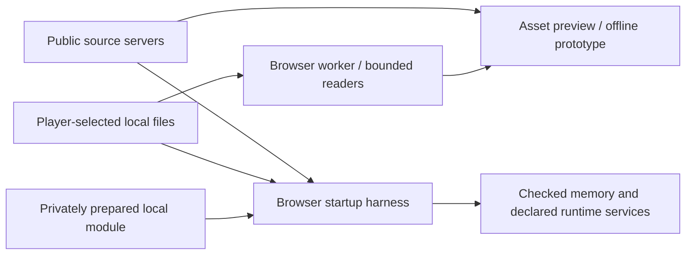

# Architecture

The public implementation uses plain JavaScript ES modules, browser HTML/CSS, and C runtime components. It contains no production game server, database, account system, or online-match service. [Current status](PROJECT_STATUS.md) records the measured startup frontier.

## Implemented components

| Path | Responsibility |
| --- | --- |
| [`apps/web/`](../apps/web/) | Offline prototype shell, renderer, input wiring, and asset worker |
| [`packages/input/`](../packages/input/) | Keyboard/gamepad ownership and focus/device safety |
| [`packages/simulation/`](../packages/simulation/) | Independently authored Twisted System research rules |
| [`src/`](../src/) | XISO/XBE/package/audio/geometry/texture/animation readers and conversion |
| [`src/runtime/`](../src/runtime/) | Checked memory, bounded device/service components, browser adapters, and report validation |
| [`proof/`](../proof/) | Separate asset conversion, disc-session, and startup proof pages/workers |
| [`tools/`](../tools/) and [`tests/`](../tests/) | Allowlisted delivery/build, preparation, fixtures, analysis wrappers, and verification |

The servers deliver source, not selected media or generated title modules. The conversion preview and independently written prototype are distinct from the private original-startup path. A public clone cannot produce an original title run from the source-only build command.

## Selected runtime route

Retained read-only analysis exports feed guarded preparation through the pinned private recompilation toolkit. Admission checks original byte identity, independent decoder agreement, full instruction/data layout, resource bounds, and checked memory. A locally compiled module is selected into a browser harness with explicit profile inputs. Original/derived code stays local.

Service adapters and synthetic device storage permit bounded progress while refusing unsupported requests. Known-value read-back is not a GPU, a register name is not a hardware implementation, and native component success does not prove title fidelity. [Runtime gates](RUNTIME_MILESTONES.md) require observed output, sustained frames, audio/control, and input-driven original screen evidence.

The production requirement adds **browser-local end-user conversion**, which the developer's Python/native compilation workflow does not deliver.

## Proposed product architecture

The earlier plan proposed TypeScript/Vite/Babylon.js, semantic HTML/React menus, headless shared simulation, Node/Colyseus match rooms, and PostgreSQL/auth persistence. None is an implemented dependency here. Framework/provider selection and compatibility with original recompilation remain gated; see [the roadmap](../DEVELOPMENT_PLAN.md).

The durable contracts are server-owned outcomes; simulation independent of DOM/rendering/transport/persistence; distinct account, connection, local profile and seat identities; four seats total; atomic tournament checkpoints/results; and separate lobby ownership, reconnect, and process recovery.

Executing original code in browsers does not automatically provide a shared deterministic authoritative simulation. A relay alone does not prove server authority, and uploaded RAM/save states may contain proprietary content. Resolve that boundary before building netcode or claiming recovery. The [risks](PROJECT_CONCERNS.md) and [local-content policy](PLAYER_SUPPLIED_CONTENT.md) retain this open question.
