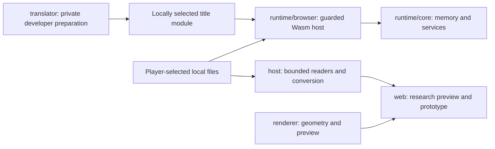

# Architecture

The public implementation uses JavaScript ES modules, HTML/CSS, C/C++ and a C# Windows launcher. It contains no production game server, database, account system or online-match service. [Status](status.md) records the retained execution frontier.

## Source boundaries

| Path | Responsibility |
| --- | --- |
| [host](../host/) | Bounded XISO/XBE/package, audio, character, geometry, texture and animation preparation |
| [translator](../translator/) | Guarded local title preparation, emitter instrumentation, seeds, translation/package verification |
| [renderer](../renderer/) | NV2A geometry prepasses and independent browser preview |
| [runtime/core](../runtime/core/) | Portable checked memory, device/service models, filesystem and scheduling |
| [runtime/browser](../runtime/browser/) | Wasm admission, browser clock/controller/input adapters, workers and report validation |
| [SDK browser](sdk-browser.md) | Full SDK/title Wasm worker, local ISO intake, software frames, input, audio and saves |
| [Windows builder](../desktop/windows/README.md) | Native local compiler/installer, Control Room launcher, settings and local UI packs |
| [web/app](../web/app/) | Offline research shell and asset worker |
| [web/proof](../web/proof/) | Local conversion/disc-session research surfaces |
| [web/prototype](../web/prototype/) | Independently authored Twisted System rules |
| [profiles](../profiles/) | Reference identities and reviewed milestone/work scope |
| [tools](../tools/) and [tests](../tests/) | Allowlisted build/servers, analysis, independent fixtures and tracking |

This adapts CTR-2-WUP's host/translator/renderer/portable-runtime/platform split. Browser platform integration lives under runtime/browser. Host preparation modules run locally in the browser where used; their directory name does not authorize remote conversion or a native end-user helper.

The source-only servers deliver reviewed code. Original media and generated title modules are selected locally. A source build does not provide an original title run.

## Selected runtime route

Retained read-only exports feed the pinned private recompilation toolkit through translator preparation. Admission checks byte identity, independent decoder agreement, full layout, resource bounds and checked memory. Private outputs remain local. M1 accepts actual original browser gameplay; M2 additionally requires the complete browser-local end-user conversion and offline game.

Known-value device read-back, component geometry comparisons and a compiled module do not prove integrated rendering or original fidelity. Runtime advances retain the control/experiment/audit protocol and their declared input assumptions.

## Product architecture still to prove

TypeScript/Vite/Babylon.js, React menus, shared simulation, Node/Colyseus and PostgreSQL/auth were proposed. Their compatibility with original recompilation remains unproved; see [the roadmap](../plans.md).

The durable contracts are authoritative server outcomes; simulation independent of rendering/transport/persistence; distinct account, connection, profile and seat identities; four seats; atomic checkpoints/results; and separate lobby ownership, reconnect and process recovery.

Original execution in each browser does not automatically provide a shared authoritative simulation. Resolve that contract while keeping proprietary code/assets/RAM/save states local. [Milestones](milestones.md), [risks](risks.md) and [content policy](content.md) retain those gates.

The [online authority assessment](online-authority-assessment.md) compares the candidate routes, defines a bounded protocol envelope and separates input sequencing, outcome authority and recovery. Its feasibility decision remains unresolved; it adds no server and does not block unrelated M1 work.
