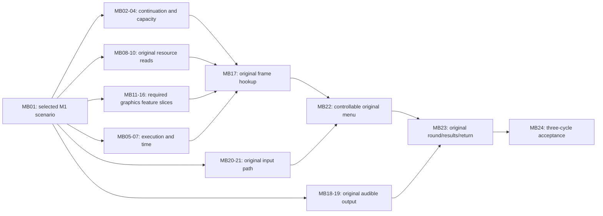

# M1 browser execution work map

This is the concrete browser work breakdown for **one original minigame, in one desktop browser, using a privately prepared local module**. It complements the [M1 scope ledger](m1-work-scope.md) and replaces a generic "browser integration is unknown" answer with named missing connections and observable completion checks. It does not add M2 conversion/catalog work, online play, accounts, mobile, or the M5 browser matrix.

<!-- browser-work:provenance:start -->
Initial source observation: `fe2c47ddc5351b9e7951a74212074c2813c5fb15`. Scope: One original minigame in one desktop browser using a privately prepared player-local module. The current development record is **M1 / awaiting-evidence**, runtime checkpoint **44**. [Status](status.md) owns accepted evidence and separately identified local candidates. Row state/evidence below describe individual connections; generating this map executes no title and accepts no checkpoint or milestone.
<!-- browser-work:provenance:end -->

## What can already be stated

| Browser capability | Existing evidence | Remaining connection |
| --- | --- | --- |
| Load and execute a private Wasm title slice | Checked module/XBE admission, fixed memory and bounded original startup run in Chrome. | Sustained execution through the original menu/game/results path. |
| Run in a worker | The proof worker executes the admitted module and reports a bounded stop. | A browser execution/presentation/input loop; the public proof is not a playable host loop. |
| Read local content | XISO range readers, a disc-session worker, original disc ownership/denial and a small synchronous Blob/Wasm fixture exist. | Successful original guest resource reads and guest-visible results. |
| Draw | Geometry prepasses, an asset preview and a bounded upstream-assembler/owned-triangle WebGL2 proof exist. | Original GPU calls/resources/state through a browser backend and into a title frame. |
| Produce sound | Narrow ADPCM/PCM preview and SDL host/silent-callback component evidence exist. | Original sound-buffer/voice behavior and audible title output. |
| Receive player input | Keyboard/gamepad prototype input and Xbox controller packet/device components exist. | A selected host input method reaching the original title's controller poll and consumer. |
| Complete a round | Original startup and the independent Twisted System prototype are separate research results. | Original menu, game, results and return, with audiovisual/input evidence, repeated three times. |

These are known integration gaps. The specific feature subset required by the chosen minigame still needs measurement; record it against the relevant row. If a row is unnecessary for the selected scenario, retain its stable ID with **Not required**, a resolution and a specific curated evidence reference. **Verified connection** also requires a resolution and specific evidence; it does not accept the M1 milestone. Added feature families stay on their owning row or become an explicitly reviewed additional row.

## How to read size and status

The size bands describe **engineering scope**, not calibrated hours or interchangeable task units:

- **S — bounded extension:** one identified existing interface, caller contract, or evidence/selection task.
- **M — shared integration:** connect several existing pieces, with state/lifetime/ABI checks and targeted verification.
- **L — subsystem work:** implement a missing browser execution or rendering/audio capability, then integrate it. Split it into observed feature families before implementation.
- A range such as **M–L** names where a particular compatibility question can change scope. Each such question is stated below. A bounded discovery result may close the question without closing the implementation item.

Starting-point labels are **bounded title evidence**, **reported local candidate**, **component evidence**, or **source/plan only**. None means the M1 capability is accepted unless its title-level exit check passes. Existing sources are reused; the map does not assign a fresh implementation for every function/import.

<!-- browser-work:inventory:start -->
There are **24 named work items**, including scope selection, integration and acceptance. They decompose the existing capability allowances; do not add them to the package forecast or derive a completion percentage. Edit the reviewed [scope data](../profiles/m1-browser-work.json), then run `npm run project:docs`; CI checks this map and the README/docs summaries against that source. Native issues own work-package status; each row records its own connection evidence. A verified row does not accept M1.
<!-- browser-work:inventory:end -->

## Largest-first implementation order

The user's priority is to tackle the largest work early and leave smaller finishing tasks until the end. **Choose the largest ready task in the order below.** MB numbers group related capabilities; they are not implementation sequence numbers. Size bands describe breadth, so this order also considers dependencies and the cost of discovering an incompatible architecture late.

Start [Goal G](local-agent-handoff.md#g-sustained-browser-execution-and-host-delivery-mb05) with the existing Fuzion SDK as the primary candidate. Reuse or reproduce a matching native desktop reference for at most 30 minutes, then attempt the first original browser frame with a progress checkpoint at 150 minutes and continued productive implementation. Implement the required shared adapters and minimum graphics connection; a desktop setup failure does not block independent browser compilation/interface work. Preserve M44 separately. Record actual execution or the reproduced compiler/browser failure and exact missing adapters; the progress checkpoint is not a stop or delivery promise.

<!-- browser-work:priorities:start -->
| Priority | Main work / structural size | Why it comes here / observable early result |
| --- | --- | --- |
| **1 — SDK integration and execution bottlenecks** | [MB04](m1-browser-work.md#mb04), [MB05](m1-browser-work.md#mb05), [MB06](m1-browser-work.md#mb06), [MB07](m1-browser-work.md#mb07) · **M–L / L** | Get the existing Fuzion SDK running in the browser. Use a short native reference check, then build-run-fix to the first original frame and a controllable original baseline. Reuse shared interfaces and supported worker/thread patterns. Defer detailed testing and per-caller audits until it works; preserve M44 and basic resource/content checks. Report progress at 150 minutes and continue productive work. |
| **2 — Original graphics, including an early title frame** | [MB11](m1-browser-work.md#mb11), [MB12](m1-browser-work.md#mb12), [MB13](m1-browser-work.md#mb13), [MB14](m1-browser-work.md#mb14), [MB15](m1-browser-work.md#mb15), [MB16](m1-browser-work.md#mb16), [MB17](m1-browser-work.md#mb17) · **M / M–L / L** | This group has the broadest known feature list. After the minimum context/surface/submission path, test **MB15 shader/combiner translation early**, then cover the required textures, surfaces and state. Use existing translators and the backend seam. Attempt an original frame as soon as its required slices work; do not wait for a complete renderer or all menu features. Component proofs alone do not close title rendering. |
| **3 — Original audio** | [MB18](m1-browser-work.md#mb18), [MB19](m1-browser-work.md#mb19) · **L / M** | Resolve format/mixer/streaming compatibility while there is still time to change the integration. Prove one required original sound through the chosen browser output, then the additional features required by the selected path. Pull forward its necessary file and timing dependencies. |
| **4 — Finish the selected startup and resource path** | [MB02](m1-browser-work.md#mb02), [MB03](m1-browser-work.md#mb03), [MB08](m1-browser-work.md#mb08), [MB09](m1-browser-work.md#mb09), [MB10](m1-browser-work.md#mb10) · **S / M–L / M** | Finish the resource/lifetime and continuation work needed for the chosen round. The subset needed for priorities 1–3 must already have been pulled forward. This position never means attempting title graphics/audio without their real resources; it defers unrelated startup families and unused loader features. |
| **5 — Original input and controllable menu** | [MB20](m1-browser-work.md#mb20), [MB21](m1-browser-work.md#mb21), [MB22](m1-browser-work.md#mb22) · **M / S–M** | Connect one chosen host method to original pad polling, verify press/release/focus behavior, and operate the original menu. Pull a minimal input connection forward if it is needed to reach an earlier proof. Full remapping and extra devices remain later-milestone scope. |
| **6 — Complete the original round/results/return** | [MB23](m1-browser-work.md#mb23) · **M–L** | This larger integration item needs the menu and shared systems first. Inventory its likely feature requirements in MB01; promote any newly observed large graphics/audio/runtime gap to its owning earlier priority instead of collecting it in a final cleanup batch. Exit with one complete original cycle. |
| **7 — Bounded corrections and M1 acceptance** | [MB24](m1-browser-work.md#mb24) · **S–M** | Complete the three consecutive audiovisual/input cycles and independent acceptance review. Required correctness checks accompany each earlier change; final acceptance is additional scenario evidence. Unrelated polish, all-game support and the broad device matrix do not enter this queue. |
<!-- browser-work:priorities:end -->

**Dependency rule:** a small task moves forward only when it enables the next large proof. Name that proof and its exact prerequisite in the task report. For example, pull MB08/09 and the necessary MB03 continuation ahead of MB17 if that frame needs an original texture read; do not serialize every possible loader/startup family ahead of all renderer work. If a private prerequisite blocks one task, preserve its stop and continue a ready source-owned compatibility/interface task. Do not substitute invented title behavior to bypass the dependency.

**Next local assignment:** [Goal G](local-agent-handoff.md#g-sustained-browser-execution-and-host-delivery-mb05) owns the SDK integration attempt under #49. Pull the minimum [Goal B](local-agent-handoff.md#b-integrated-browser-graphics-beyond-the-owned-triangle-proof) graphics seam/translation work into its first-frame experiment with explicit ownership. Use Goal D only for an actual legacy admission blocker; declare separate SDK candidate limits rather than inheriting proof limits; detailed review follows the working baseline. Goals A/C supply only the continuation/read prerequisites the attempted path needs. Goal H follows for audio. Keep scope and acceptance evidence distinct from the selected implementation order.

At the first original frame, first audible original sound and first complete cycle, update the affected rows' feature inventories, remaining connections and measured effort ranges. Newly exposed subsystem work returns to the appropriate earlier priority. Leave small optional refinements until the selected M1 path has passed.

## Execution and startup

Evidence: [title admission](../runtime/browser/local-title-proof.mjs), [Wasm policy](../runtime/browser/wasm-proof.mjs), [thread worker](../runtime/browser/thread-proof-worker.mjs), [preparation](../translator/prepare-title-recomp.py), [current task](handoff.md), and [scope ledger](m1-work-scope.md).

<!-- browser-work:startup:start -->
| ID / work | Starting point and missing browser connection | Completion check and bounded question | Size / evidence |
| --- | --- | --- | --- |
| <a id="mb01"></a>**MB01 — Freeze the M1 scenario** | The browser preview and working Windows reference are available. Choose one compatible ISO, browser/device, minigame and input/seat recipe for the first browser run. | Record one repeatable browser scenario and reuse the existing native reference. Keep source/module, local image identity, browser/device and input/seat details with the observed result. | **S** · Open; [source/plan only](status.md) · [tracked delivery](https://github.com/Jdiller-86/fuzion-frenzy-web-port/issues?q=is%3Aissue%20label%3Awork%3Adelivery%20%22m1-build-execution%22) |
| <a id="mb02"></a>**MB02 — Assess the reached 4EA30 caller** | The retained R3 startup candidate stops before 4EA30. This is a legacy proof-path question, not a prerequisite for running the full SDK browser candidate. | Produce the retained byte/layout, caller/argument/resource/provider contract and direct-dependency list for this exact invocation. Mark any missing authority. This is a bounded assessment, not permission to admit the body. | **S** · Open; [reported local candidate](status.md) · [tracked delivery](https://github.com/Jdiller-86/fuzion-frenzy-web-port/issues?q=is%3Aissue%20label%3Awork%3Adelivery%20%22m1-build-resources%22) |
| <a id="mb03"></a>**MB03 — Complete the selected startup continuation** | The full SDK boot path compiles with the original title. Its actual browser startup and resource continuation need a player-local ISO run; the legacy M44 stop is a separate reference. | The assessed family returns to its actual original caller with required state preserved, or names the next unsupported family and its exact missing capability. Use MB02 first; assign child batches to this row instead of predicting a task per stop. Additional families before the menu remain conditional work. | **M–L** · Awaiting evidence; [component evidence](sdk-browser.md) · [tracked delivery](https://github.com/Jdiller-86/fuzion-frenzy-web-port/issues?q=is%3Aissue%20label%3Awork%3Adelivery%20%22m1-build-resources%22) |
| <a id="mb04"></a>**MB04 — Establish title-slice admission capacity** | All 91 source objects, including 64 title shards plus mapping, compile and link in the full SDK browser candidate. Its memory/dispatch route is separate from M44; runtime capacity remains unverified. | Declare actual candidate resource/import/export/function/binding limits and checked dispatch; use quick identity/budget checks and refuse over-budget execution. Preserve M44. The SDK candidate need not inherit legacy 512/64 ceilings. Complete detailed contract certification and independent review after the working baseline, before accepting this connection. | **M–L** · Awaiting evidence; [component evidence](sdk-browser.md) · [tracked delivery](https://github.com/Jdiller-86/fuzion-frenzy-web-port/issues?q=is%3Aissue%20label%3Awork%3Adelivery%20%22m1-build-execution%22) |
<!-- browser-work:startup:end -->

## Browser loop, guest contexts and time

Evidence: the [public proof worker](../runtime/browser/startup-proof-worker.mjs) and [thread worker](../runtime/browser/thread-proof-worker.mjs) invoke `ff_probe_run()` synchronously for a bounded report. [host-step](../runtime/browser/host-step.mjs) is only an accumulator; its own contract says it executes no guest code and samples no input. [Thread contexts](../runtime/core/thread_bootstrap.c), [timers](../runtime/core/kernel_timers.c), [DPC context](../runtime/core/dpc_context.c), and [browser clocks](../runtime/browser/browser-clock.mjs) are reusable components.

<!-- browser-work:loop:start -->
| ID / work | Starting point and missing browser connection | Completion check and bounded question | Size / evidence |
| --- | --- | --- | --- |
| <a id="mb05"></a>**MB05 — Connect sustained execution to browser delivery** | The compiled candidate runs guest execution in a pthread worker with host frame/input/audio bridges. Sustained browser responsiveness and performance remain unmeasured. | Guest execution progresses with preserved state while required host input/frame/audio delivery remains responsive. Select a supported worker/pthread or other reviewed arrangement; a custom pause/resume API is not a prerequisite. Record actual browser progress and stalls; an accumulator or repeated fresh start is only component evidence. | **L** · Awaiting evidence; [component evidence](sdk-browser.md) · [tracked delivery](https://github.com/Jdiller-86/fuzion-frenzy-web-port/issues?q=is%3Aissue%20label%3Awork%3Adelivery%20%22m1-build-execution%22) |
| <a id="mb06"></a>**MB06 — Execute the required guest contexts/callbacks** | SDK guest boot, threads, TLS and kernel services are linked into the browser build. Required callback and wait behavior still needs an actual game run. | Each context/callback required by the scenario enters, returns or blocks/wakes with correct ownership and preserved state. Use only the scheduling behaviors actually required; prove the selected callback before building a general scheduler. Question: which callbacks/waits does MB01 exercise? | **M–L** · Awaiting evidence; [component evidence](sdk-browser.md) · [tracked delivery](https://github.com/Jdiller-86/fuzion-frenzy-web-port/issues?q=is%3Aissue%20label%3Awork%3Adelivery%20%22m1-build-execution%22) |
| <a id="mb07"></a>**MB07 — Deliver required clock/timer events consistently** | SDK timing and browser host delivery are connected in source. Timer ordering, stalls and audio/input timing remain unverified during browser gameplay. | Guest-observed time, required timer/DPC delivery and input/audio ordering agree for the selected foreground scenario and defined stalls. Question: which clock consumers and timer events are actually required? Share one reviewed policy with MB05/06; broad device timing calibration belongs beyond this gate. | **M–L** · Awaiting evidence; [component evidence](sdk-browser.md) · [tracked delivery](https://github.com/Jdiller-86/fuzion-frenzy-web-port/issues?q=is%3Aissue%20label%3Awork%3Adelivery%20%22m1-build-execution%22) |
<!-- browser-work:loop:end -->

## Original local resource reads

Evidence: [disc-session core](../runtime/browser/disc-session-core.mjs), [worker](../runtime/browser/disc-session-worker.mjs), [XDVDFS](../host/xdvdfs.mjs), [file diagnostics](../runtime/browser/file-request.mjs), [local disc model](../runtime/core/local_disc.c), and [research](research.md). The current title module's admitted host import is the clock. The four-byte synchronous Blob/Wasm fixture and modeled disc denial are separate evidence; neither implements successful original file reads.

<!-- browser-work:resources:start -->
| ID / work | Starting point and missing browser connection | Completion check and bounded question | Size / evidence |
| --- | --- | --- | --- |
| <a id="mb08"></a>**MB08 — Bridge a selected local range into guest I/O** | The local ISO reader validates DEFAULT.XBE and lazily mounts the image through WORKERFS for the SDK disc reader. Actual guest reads need runtime observation. | A source-supported original request reaches the local reader and exact bytes reach the checked guest destination. Define worker/synchronous delivery, ownership and error/cleanup behavior; review any new host capability explicitly. Question: which reached request supplies the first unambiguous path/range/buffer contract? | **M** · Awaiting evidence; [component evidence](sdk-browser.md) · [tracked delivery](https://github.com/Jdiller-86/fuzion-frenzy-web-port/issues?q=is%3Aissue%20label%3Awork%3Adelivery%20%22m1-build-resources%22) |
| <a id="mb09"></a>**MB09 — Complete the required guest file lifecycle** | The SDK disc/file lifecycle is compiled into the candidate. Successful original open/read/query/close behavior is not yet observed in the browser. | The selected original open/read/query/close sequence returns actual bytes/status/IOSB and releases ownership without affecting unrelated files. Implement only the target's requested operations; reuse MB08 transport. | **M** · Awaiting evidence; [component evidence](sdk-browser.md) · [tracked delivery](https://github.com/Jdiller-86/fuzion-frenzy-web-port/issues?q=is%3Aissue%20label%3Awork%3Adelivery%20%22m1-build-resources%22) |
| <a id="mb10"></a>**MB10 — Load the selected game's required resources** | The candidate mounts original files for the title loader rather than converting research-preview assets. Actual package loading and resource lifetime remain unverified. | The original loader reaches its real continuation with the required on-device resources and lifetimes. Inventory its package/format needs and choose existing original/SDK providers. GPU texture/shader translation belongs to MB14/15 and audio decoding to MB18; do not count those implementations twice. Question: which extra non-GPU/non-audio provider gaps remain? | **M–L** · Awaiting evidence; [component evidence](sdk-browser.md) · [tracked delivery](https://github.com/Jdiller-86/fuzion-frenzy-web-port/issues?q=is%3Aissue%20label%3Awork%3Adelivery%20%22m1-build-resources%22) |
<!-- browser-work:resources:end -->

## Original graphics in the browser

Evidence: [architecture](architecture.md), [graphics research](research.md), [preview](../renderer/preview.mjs), [triangle](../renderer/nv2a_triangle.c), [line](../renderer/nv2a_line.c), [quad](../renderer/nv2a_quad.c), and [submission probe](../runtime/browser/submission-probe.mjs). The retained SDK `gpu::Backend`/normalized-state seam assessment and owned-triangle upstream-assembler proof are useful foundations. The preview's fixed shader, camera and asset rendering are not the original renderer. Native D3D12/Vulkan backends are not browser implementations.

<!-- browser-work:graphics:start -->
| ID / work | Starting point and missing browser connection | Completion check and bounded question | Size / evidence |
| --- | --- | --- | --- |
| <a id="mb11"></a>**MB11 — Select context ownership and wire the backend seam** | The SDK CPU reference renderer is connected to the browser worker and canvas. An accelerated browser backend is not implemented; measure the existing route first. | The SDK GPU path calls one selected browser backend/context through a checked resource boundary with teardown. Adapt its real shader/surface/submission requirements and applicable OpenCE WebGL2 patterns. Resolve ownership by a runnable build/browser attempt; avoid implementing multiple competing architectures. | **M** · Awaiting evidence; [component evidence](sdk-browser.md) · [tracked delivery](https://github.com/Jdiller-86/fuzion-frenzy-web-port/issues?q=is%3Aissue%20label%3Awork%3Adelivery%20%22m1-build-graphics%22) |
| <a id="mb12"></a>**MB12 — Render surfaces and present frames** | Frame transport and canvas presentation are implemented for the software backend. An identified original browser frame, dimensions and surface behavior remain unobserved. | The selected surface/target allocation, lifetime and final presentation path produces a frame on the intended canvas with correct dimensions. Reuse MB11 ownership; MB16 owns clear/viewport/state ordering. Question: which target/surface formats and transitions does the first original frame need? | **M–L** · Awaiting evidence; [component evidence](sdk-browser.md) · [tracked delivery](https://github.com/Jdiller-86/fuzion-frenzy-web-port/issues?q=is%3Aissue%20label%3Awork%3Adelivery%20%22m1-build-graphics%22) |
| <a id="mb13"></a>**MB13 — Submit vertices, indices and primitives** | The compiled SDK reference renderer supplies vertex/index/primitive paths. Required original submissions still need comparison against the working native reference. | The target's required vertex/index layouts, spans and primitive paths produce independently checked buffers/draws; unsupported layouts stop before unsafe access. Start from the first observed submission, then list additional required layouts. | **M** · Awaiting evidence; [component evidence](sdk-browser.md) · [tracked delivery](https://github.com/Jdiller-86/fuzion-frenzy-web-port/issues?q=is%3Aissue%20label%3Awork%3Adelivery%20%22m1-build-graphics%22) |
| <a id="mb14"></a>**MB14 — Upload textures and apply sampler state** | SDK texture/sampler handling is compiled and the shared texture-cascade fix is applied. Browser texture coverage and appearance remain unverified. | The selected title texture formats/levels upload and sample correctly through checked ownership, with unsupported formats refused. Question: which actual format/stride/filter/addressing combinations does MB01 require? | **M–L** · Awaiting evidence; [component evidence](sdk-browser.md) · [tracked delivery](https://github.com/Jdiller-86/fuzion-frenzy-web-port/issues?q=is%3Aissue%20label%3Awork%3Adelivery%20%22m1-build-graphics%22) |
| <a id="mb15"></a>**MB15 — Translate required shader/combiner programs** | The candidate reuses the SDK CPU shader/combiner paths and shared fixed-function correction. Original browser shader output and performance remain unverified. | Required original vertex-program/pixel-combiner paths execute through the selected backend with a checked reference comparison. Inventory actual instructions, constants and combiners, including skinning inputs only if the target uses them, then split feature families. Question: which title programs/features can existing translators cover? | **L** · Awaiting evidence; [component evidence](sdk-browser.md) · [tracked delivery](https://github.com/Jdiller-86/fuzion-frenzy-web-port/issues?q=is%3Aissue%20label%3Awork%3Adelivery%20%22m1-build-graphics%22) |
| <a id="mb16"></a>**MB16 — Apply observed draw-state sequences** | The software backend reuses SDK render-state handling. The D3D12 descriptor fix is native-only; browser state ordering and fidelity still need observation. | The target's observed viewport, clear, depth/stencil/blend/cull and draw ordering produce the expected sequence. Add a fence/synchronization feature only when the selected call path requires it. Use source/reference semantics, not synthetic read-back as GPU-ready evidence. Keep texture/shader implementation in MB14/15; this row owns state ordering. | **M–L** · Awaiting evidence; [component evidence](sdk-browser.md) · [tracked delivery](https://github.com/Jdiller-86/fuzion-frenzy-web-port/issues?q=is%3Aissue%20label%3Awork%3Adelivery%20%22m1-build-graphics%22) |
| <a id="mb17"></a>**MB17 — Join the backend to an actual original frame** | The complete frame pipeline compiles and the browser preview is published. No actual original browser frame is recorded in this workspace. | The SDK browser candidate presents an identified original frame using actual local resources/state, with native-reference comparison where available. Pull only the required MB11-16 and startup/resource fixes into the Goal G attempt; report the actual failed stage and missing feature when blocked. A desktop frame or owned triangle does not satisfy this row. | **M** · Awaiting evidence; [component evidence](sdk-browser.md) · [tracked delivery](https://github.com/Jdiller-86/fuzion-frenzy-web-port/issues?q=is%3Aissue%20label%3Awork%3Adelivery%20%22m1-build-graphics%22) |
<!-- browser-work:graphics:end -->

## Audible original audio and player input

Evidence: the [narrow mono ADPCM decoder](../host/audio.mjs), [audio preview](../web/proof/main.mjs), [SDL browser fixture](../tools/fixtures/sdl_browser_check.c), [controller adapter](../runtime/browser/gamepad-adapter.mjs), [controller source](../runtime/browser/controller-source.mjs), [controller device](../runtime/core/controller_device.c), [controller packet](../runtime/core/controller_packet.c), and [prototype input](../runtime/browser/input/local-input.mjs). A silent callback does not establish original audible audio. Prototype input and an empty original device snapshot do not establish connected original polling.

<!-- browser-work:audio-input:start -->
| ID / work | Starting point and missing browser connection | Completion check and bounded question | Size / evidence |
| --- | --- | --- | --- |
| <a id="mb18"></a>**MB18 — Supply the required original sound-buffer/voice behavior** | SDK sound processing is linked to browser PCM delivery. Actual title format/voice coverage and audible output remain unverified. | A selected original sound request produces the correct bounded PCM/buffer state, with required start/stop/loop/voice behavior. Reuse native/SDL components where compatible. Question: which formats, mixer features and streaming behaviors are actually used by the target? Add only that subset first. | **L** · Awaiting evidence; [component evidence](sdk-browser.md) · [tracked delivery](https://github.com/Jdiller-86/fuzion-frenzy-web-port/issues?q=is%3Aissue%20label%3Awork%3Adelivery%20%22m1-build-audio%22) |
| <a id="mb19"></a>**MB19 — Deliver audible browser output** | The browser audio bridge is implemented. User activation, audible game output, underruns and timing need an actual browser run. | MB18's original sound reaches the chosen browser output after permitted user activation, with sample/clock/lifecycle evidence and audible output. Measure underruns and teardown; use MB05/07's scheduling policy. Select one output route rather than requiring both WebAudio and SDL implementations. | **M** · Awaiting evidence; [component evidence](sdk-browser.md) · [tracked delivery](https://github.com/Jdiller-86/fuzion-frenzy-web-port/issues?q=is%3Aissue%20label%3Awork%3Adelivery%20%22m1-build-audio%22) |
| <a id="mb20"></a>**MB20 — Connect one host input method to original pad polling** | Keyboard and standard-gamepad input feed the browser worker and SDK pad interface. Original menu/game response remains unverified. | The chosen keyboard-to-virtual-pad or physical-gamepad path changes the original guest controller packet and the title consumes it. Match packet/device/mapping contracts to retained evidence. M1 does not require every input device; keyboard input does not imply adding an original Xbox keyboard device. | **M** · Awaiting evidence; [component evidence](sdk-browser.md) · [tracked delivery](https://github.com/Jdiller-86/fuzion-frenzy-web-port/issues?q=is%3Aissue%20label%3Awork%3Adelivery%20%22m1-build-round-path%22) |
| <a id="mb21"></a>**MB21 — Deliver fresh input and clear stale actions** | The browser shell clears held keyboard input on focus loss and delivers pad updates to the worker. Stale-action and physical-device behavior need runtime observation. | Press/release and focus loss reach the selected guest controller without stale or reordered actions. If the chosen path uses Gamepad API, verify its main-thread/proxy requirement. Use MB05/07 and the selected input method; full remapping/all-device acceptance belongs to later milestones. | **S–M** · Awaiting evidence; [component evidence](sdk-browser.md) · [tracked delivery](https://github.com/Jdiller-86/fuzion-frenzy-web-port/issues?q=is%3Aissue%20label%3Awork%3Adelivery%20%22m1-build-round-path%22) |
<!-- browser-work:audio-input:end -->

## Original menu, round and results

Evidence: [M1 acceptance](milestones.md#m1--original-browser-execution), [current title boundary](status.md), and [report comparison infrastructure](../tools/compare-proof-profiles.mjs). The independently authored prototype does not provide original rules, menu or round acceptance.

<!-- browser-work:rounds:start -->
| ID / work | Starting point and missing browser connection | Completion check and bounded question | Size / evidence |
| --- | --- | --- | --- |
| <a id="mb22"></a>**MB22 — Operate the original menu** | The native reference is reported working; the browser candidate now includes rendering and input. Original browser menu control is still unobserved. | Original menu output responds to recorded input and selects the target route. Compose MB03/05, required resources, MB17 and MB20/21; identify any newly reached capability against its owning row. | **M** · Open; [source/plan only](status.md) · [tracked delivery](https://github.com/Jdiller-86/fuzion-frenzy-web-port/issues?q=is%3Aissue%20label%3Awork%3Adelivery%20%22m1-build-round-path%22) |
| <a id="mb23"></a>**MB23 — Complete the selected original round and return** | The compiled browser candidate includes the original title path. No complete original browser minigame/results/menu cycle has been recorded. | The selected original round reaches results and returns to the original menu, with required audio and input. Reuse shared paths; add only the newly observed target-specific feature gaps. No approximate rules or replacement scenes. Question: what does this path exercise beyond the menu? | **M–L** · Open; [source/plan only](status.md) · [tracked delivery](https://github.com/Jdiller-86/fuzion-frenzy-web-port/issues?q=is%3Aissue%20label%3Awork%3Adelivery%20%22m1-build-round-path%22) |
| <a id="mb24"></a>**MB24 — Accept three complete cycles** | The three-cycle acceptance gate remains open. Published builds and native reports do not substitute for browser cycles and acceptance review. | Three consecutive original menu/game/results/menu cycles pass with visible output, audible audio, recorded input, source/module/device identities, control comparison and independent acceptance review. Targeted component results feed the gate; task closure alone cannot accept it. | **S–M** · Open; [source/plan only](status.md) · [tracked delivery](https://github.com/Jdiller-86/fuzion-frenzy-web-port/issues?q=is%3Aissue%20label%3Awork%3Adelivery%20%22m1-verify-cycles%22) |
<!-- browser-work:rounds:end -->

## Dependency view and useful parallel work

This is an **integration dependency sketch**, not a recovered original call graph or a claim that every conditional scheduler/format feature will be needed. MB01's observed scenario must refine it.



Use the [largest-first order](#largest-first-implementation-order) to select the next assignment. Source-owned MB11/15 backend and translator compatibility work can proceed while the local runtime owner assesses a needed MB02 continuation; MB08's transport contract can also be investigated without inventing an original file result. Actual title proof remains local. Keep the repository's two-worker limit, give each worker independent files and reserve independent correctness review where required.

## Turn the remaining questions into measurements

Three focused records should refine this map without waiting for all browser startup to work:

1. **Target requirement record (MB01):** select the game/path; use matching native reference observations when locally available and retained original/static evidence. Record required resources, graphics/audio/input features and unresolved callbacks. Native HLE substitutions are reference requirements, not proof of the browser's original execution path. Do not repeat the existing whole-image scan merely to increase counts.
2. **Browser compatibility record (MB08/11/15/18):** for each shared seam, name the retained implementation, raw-pointer/host-thread/file/API assumptions to adapt, first proof, remaining features and explicit refusals. Start with the highest-impact renderer feature and positive resource transport. Existing owned-triangle and Blob fixtures are starting evidence, not new deliverables to repeat.
3. **Per-row effort record:** record prepare/build/browser/review/rework time for representative bounded, shared-integration and subsystem slices using the [iteration workflow](development-workflow.md). Include analysis and review effort; the roughly 51-second cached build and 3.6-second harness are only parts of an iteration. Replace S/M/L with evidence-backed ranges as comparable work accumulates. Keep unresolved feature breadth on its owning row with a named next measurement.

A task-size claim must cite its interface/feature inventory and reuse assumptions. If a needed feature is absent from the selected path, remove it with that evidence rather than implementing every static candidate. If a reusable backend fails a compatibility experiment, split that row and revise its allowance openly.

## Required M1 progress report

For any M1 implementation session, report its **MB row plus the current SCOPE task**, the exact changed connection, and the next row that can proceed. Update only affected rows/evidence; do not run a full audit for each routine. Use this format:

```text
Browser work item: MBxx (and SCOPE-xx where applicable)
Before -> after: source/plan | component evidence | reported title candidate | reviewed title result
Connection delivered: <specific guest/host or backend interface>
Observed completion check: <what actually ran; source/module/input/device identities>
Remaining work in this row: <named features or integration steps>
Next measurement: <specific trace, interface check or bounded experiment>
Size/range revision: <evidence and assumptions, including unchanged when justified>
Next dependent row: <ID and why it is now unblocked>
```

Do not substitute function totals, compiler success, synthetic device values or fixture counts for these browser results. Keep original content, generated title code and raw traces private. Preserve the accepted checkpoint and local-candidate distinction from [status](status.md); only the normal milestone acceptance record can close M1.
