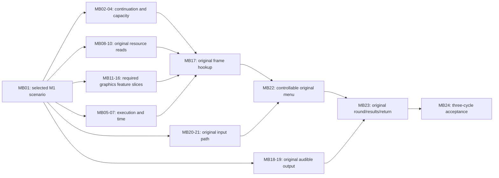

# M1 browser execution work map

This is the concrete browser work breakdown for **one original minigame, in one desktop browser, using a privately prepared local module**. It complements the [M1 scope ledger](m1-work-scope.md) and replaces a generic "browser integration is unknown" answer with named missing connections and observable completion checks. It does not add M2 conversion/catalog work, online play, accounts, mobile, or the M5 browser matrix.

The source observation is PR #46 at `716eb55527d2b22869619d07234a0300766cc5b1`. [Status](status.md) owns current evidence: M44 is the accepted checkpoint; the separately reviewed local R3 logger continuation reaches the unadmitted `0x4EA30` caller. The public source and curated local results establish the starting points below. This map itself executes no title and promotes no checkpoint.

## What can already be stated

| Browser capability | Existing evidence | Remaining connection |
| --- | --- | --- |
| Load and execute a private Wasm title slice | Checked module/XBE admission, fixed memory and bounded original startup run in Chrome. | Sustained execution through the original menu/game/results path. |
| Run in a worker | The proof worker executes the admitted module and reports a bounded stop. | A browser execution/presentation/input loop; the public proof is not a playable host loop. |
| Read local content | XISO range readers, a disc-session worker, original disc ownership/denial and a small synchronous Blob/Wasm fixture exist. | Successful original guest resource reads and guest-visible results. |
| Draw | Geometry prepasses, an asset preview and a bounded upstream-assembler/owned-triangle WebGL2 proof exist. | Original GPU calls/resources/state through a browser backend and into a title frame. |
| Produce sound | Narrow ADPCM/PCM preview and SDL host/silent-callback component evidence exist. | Original sound-buffer/voice behavior and audible title output. |
| Receive player input | Keyboard/gamepad prototype input and Xbox controller packet/device components exist. | A selected host input method reaching the original title's controller poll and consumer. |
| Complete a round | Original startup and the independent Twisted System prototype are separate research results. | Original menu, game, results and return, with audiovisual/input evidence, repeated three times. |

These are known integration gaps. The specific feature subset required by the chosen minigame still needs measurement; it should be recorded against the relevant row rather than making the whole project "unknown".

## How to read size and status

The size bands describe **engineering scope**, not calibrated hours or interchangeable task units:

- **S — bounded extension:** one identified existing interface, caller contract, or evidence/selection task.
- **M — shared integration:** connect several existing pieces, with state/lifetime/ABI checks and targeted verification.
- **L — subsystem work:** implement a missing browser execution or rendering/audio capability, then integrate it. Split it into observed feature families before implementation.
- A range such as **M–L** names where a particular compatibility question can change scope. Each such question is stated below. A bounded discovery result may close the question without closing the implementation item.

Starting-point labels are **bounded title evidence**, **reported local candidate**, **component evidence**, or **source/plan only**. None means the M1 capability is accepted unless its title-level exit check passes. Existing sources are reused; the map does not assign a fresh implementation for every function/import.

There are **24 named work items**, including scope selection, integration and acceptance. They are a decomposition of the existing capability allowances, **not 24 newly discovered mandatory defects or a replacement 24-task estimate**. Do not add them to the 16/28/49 forecast. Split or remove a row when actual target-path evidence supports it, retaining the reason. No completion percentage follows from this list.

## Largest-first implementation order

The user's priority is to tackle the largest work early and leave smaller finishing tasks until the end. **Choose the largest ready task in the order below.** MB numbers group related capabilities; they are not implementation sequence numbers. Size bands describe breadth, so this order also considers dependencies and the cost of discovering an incompatible architecture late.

Start with a bounded enabling pass: record MB01's selected scenario and provisional feature requirements; inspect MB04's target demand/headroom; choose MB11's context ownership and MB05's execution/delivery boundary. These are decisions and compatibility spikes, not a requirement to finish every startup helper, capacity change or renderer feature before implementation. Assess MB02 when the chosen original continuation needs it. Preserve the accepted checkpoint and separately identify any local candidate used.

| Priority | Main work | Why it comes here / observable early result |
| --- | --- | --- |
| **1 — Runtime and admission bottlenecks** | **MB04–MB07**: capacity route, sustained execution, required contexts and clock delivery. **L / M–L.** | Execution boundaries and host-thread delivery constrain graphics, audio and input. Establish a viable target admission route and demonstrate continuing guest execution with preserved state and responsive browser delivery. Implement only the contexts/timers the target requires; keep later title audio/input timing checks explicit. A general Xbox scheduler is not an exit requirement. |
| **2 — Original graphics, including an early title frame** | **MB11–MB16**, followed immediately by **MB17** when enabled. **L / M–L / M.** | This group has the broadest known feature list. After the minimum context/surface/submission path, test **MB15 shader/combiner translation early**, then cover the required textures, surfaces and state. Use existing translators and the backend seam. Attempt an original frame as soon as its required slices work; do not wait for a complete renderer or all menu features. Component proofs alone do not close title rendering. |
| **3 — Original audio** | **MB18 → MB19**: sound-buffer/voice behavior, then audible browser delivery. **L → M.** | Resolve format/mixer/streaming compatibility while there is still time to change the integration. Prove one required original sound through the chosen browser output, then the additional features required by the selected path. Pull forward its necessary file and timing dependencies. |
| **4 — Finish the selected startup and resource path** | Remaining **MB02/MB03** and **MB08–MB10** work. **S / M–L / M.** | Finish the resource/lifetime and continuation work needed for the chosen round. The subset needed for priorities 1–3 must already have been pulled forward. This position never means attempting title graphics/audio without their real resources; it defers unrelated startup families and unused loader features. |
| **5 — Original input and controllable menu** | **MB20 → MB21 → MB22**. **M / S–M / M.** | Connect one chosen host method to original pad polling, verify press/release/focus behavior, and operate the original menu. Pull a minimal input connection forward if it is needed to reach an earlier proof. Full remapping and extra devices remain later-milestone scope. |
| **6 — Complete the original round/results/return** | **MB23**, reusing the preceding systems. **M–L.** | This larger integration item needs the menu and shared systems first. Inventory its likely feature requirements in MB01; promote any newly observed large graphics/audio/runtime gap to its owning earlier priority instead of collecting it in a final cleanup batch. Exit with one complete original cycle. |
| **7 — Bounded corrections and M1 acceptance** | Required remaining small corrections on the chosen path, then **MB24**. **S–M.** | Complete the three consecutive audiovisual/input cycles and independent acceptance review. Required correctness checks accompany each earlier change; final acceptance is additional scenario evidence. Unrelated polish, all-game support and the broad device matrix do not enter this queue. |

**Dependency rule:** a small task moves forward only when it enables the next large proof. Name that proof and its exact prerequisite in the task report. For example, pull MB08/09 and the necessary MB03 continuation ahead of MB17 if that frame needs an original texture read; do not serialize every possible loader/startup family ahead of all renderer work. If a private prerequisite blocks one task, preserve its stop and continue a ready source-owned compatibility/interface task. Do not substitute invented title behavior to bypass the dependency.

**Next local assignment:** after the enabling decisions, use [Goal G](local-agent-handoff.md#g-sustained-browser-execution-and-host-delivery-mb05) for the first supported MB05 execution/delivery slice. Use Goal D for a demonstrated admission blocker. Next take [Goal B](local-agent-handoff.md#b-integrated-browser-graphics-beyond-the-owned-triangle-proof), first fixing MB11's seam and testing the highest-impact required MB15 translation path. Goals A/C supply only the original continuation/read prerequisites those proofs need; the ongoing SCOPE-37 stop is not a global gate on independent browser work. Goal H covers the following audio slice. Each assignment remains one bounded deliverable with its own review and stop condition.

At the first original frame, first audible original sound and first complete cycle, update the affected rows' feature inventories, remaining connections and measured effort ranges. Newly exposed subsystem work returns to the appropriate earlier priority. Leave small optional refinements until the selected M1 path has passed.

## Execution and startup

Evidence: [title admission](../runtime/browser/local-title-proof.mjs), [Wasm policy](../runtime/browser/wasm-proof.mjs), [thread worker](../runtime/browser/thread-proof-worker.mjs), [preparation](../translator/prepare-title-recomp.py), [current task](handoff.md), and [scope ledger](m1-work-scope.md).

| ID / work | Starting point and missing browser connection | Completion check and bounded question | Size |
| --- | --- | --- | --- |
| **MB01 — Freeze the M1 scenario** | M1's three-cycle gate is defined; a specific game/input/browser execution recipe must be recorded. Select one compatible build, minigame, desktop browser/device and input/seat configuration. | A repeatable original menu-to-results input recipe and required feature list exist. Choose the target from evidence; the prototype's game is not automatically the least costly original path. | S |
| **MB02 — Assess the reached 4EA30 caller** | Reported local R3 returns through the logger and stops before this caller's body. Its name/behavior is not established by its address. | Produce the retained byte/layout, caller/argument/resource/provider contract and direct-dependency list for this exact invocation. Mark any missing authority. This is a bounded assessment, not permission to admit the body. | S |
| **MB03 — Complete the selected startup continuation** | Startup still has an active original enclosing function; existing C/SDK providers can be reused where their contracts apply. | The assessed family returns to its actual original caller with required state preserved, or names the next unsupported family and its exact missing capability. Use MB02 first; assign child batches to this row instead of predicting a task per stop. Additional families before the menu remain conditional work. | M–L |
| **MB04 — Establish title-slice admission capacity** | The accepted profile uses 511/512 function charges and 64/64 bindings. Whole-image generation is separate from browser admission. | A target-path inventory and retention/dispatch comparison show a viable capacity route. First inspect duplicate/unused representations; any change to ceilings/module contracts needs its own scoped review. Question: what capacity does MB01's path actually demand? Do not silently raise limits. | M–L |

## Browser loop, guest contexts and time

Evidence: the [public proof worker](../runtime/browser/startup-proof-worker.mjs) and [thread worker](../runtime/browser/thread-proof-worker.mjs) invoke `ff_probe_run()` synchronously for a bounded report. [host-step](../runtime/browser/host-step.mjs) is only an accumulator; its own contract says it executes no guest code and samples no input. [Thread contexts](../runtime/core/thread_bootstrap.c), [timers](../runtime/core/kernel_timers.c), [DPC context](../runtime/core/dpc_context.c), and [browser clocks](../runtime/browser/browser-clock.mjs) are reusable components.

| ID / work | Starting point and missing browser connection | Completion check and bounded question | Size |
| --- | --- | --- | --- |
| **MB05 — Connect sustained execution to browser delivery** | Worker startup works; no accepted playable execution/input/presentation loop exists. Select a safe stepping/yield or other reviewed delivery scheme instead of assuming the proof's one-shot run is sufficient. | Guest execution continues while required input, frame and audio delivery remain responsive. Preserve actual guest context and unsupported stops. Question: which existing generated execution boundary can safely support the chosen scheme? Do not infer original timing from the accumulator's default 60 Hz. | L |
| **MB06 — Execute the required guest contexts/callbacks** | Context creation, TLS/FS/frame components and selected immediate synchronization models exist; a READY context or admitted callback is not proof it ran. | Each context/callback required by the scenario enters, returns or blocks/wakes with correct ownership and preserved state. Use only the scheduling behaviors actually required; prove the selected callback before building a general scheduler. Question: which callbacks/waits does MB01 exercise? | M–L |
| **MB07 — Deliver required clock/timer events consistently** | Clock values, timer queues and DPC components are tested separately. Their existence does not connect elapsed browser time to original callback delivery. | Guest-observed time, required timer/DPC delivery and input/audio ordering agree for the selected foreground scenario and defined stalls. Question: which clock consumers and timer events are actually required? Share one reviewed policy with MB05/06; broad device timing calibration belongs beyond this gate. | M–L |

## Original local resource reads

Evidence: [disc-session core](../runtime/browser/disc-session-core.mjs), [worker](../runtime/browser/disc-session-worker.mjs), [XDVDFS](../host/xdvdfs.mjs), [file diagnostics](../runtime/browser/file-request.mjs), [local disc model](../runtime/core/local_disc.c), and [research](research.md). The current title module's admitted host import is the clock. The four-byte synchronous Blob/Wasm fixture and modeled disc denial are separate evidence; neither implements successful original file reads.

| ID / work | Starting point and missing browser connection | Completion check and bounded question | Size |
| --- | --- | --- | --- |
| **MB08 — Bridge a selected local range into guest I/O** | The selected File/Blob can be inspected and read in bounded ranges; the title's supported read interface is not connected to that reader. | A source-supported original request reaches the local reader and exact bytes reach the checked guest destination. Define worker/synchronous delivery, ownership and error/cleanup behavior; review any new host capability explicitly. Question: which reached request supplies the first unambiguous path/range/buffer contract? | M |
| **MB09 — Complete the required guest file lifecycle** | Namespace, handles, FATX and selected negative disc-open behavior exist. Successful disc opens, reads, positions/queries and closes remain caller-specific. | The selected original open/read/query/close sequence returns actual bytes/status/IOSB and releases ownership without affecting unrelated files. Implement only the target's requested operations; reuse MB08 transport. | M |
| **MB10 — Load the selected game's required resources** | Asset/package preview parsers and generated title code exist. Preview reads do not establish that the original loader can consume its resources. | The original loader reaches its real continuation with the required on-device resources and lifetimes. Inventory its package/format needs and choose existing original/SDK providers. GPU texture/shader translation belongs to MB14/15 and audio decoding to MB18; do not count those implementations twice. Question: which extra non-GPU/non-audio provider gaps remain? | M–L |

## Original graphics in the browser

Evidence: [architecture](architecture.md), [graphics research](research.md), [preview](../renderer/preview.mjs), [triangle](../renderer/nv2a_triangle.c), [line](../renderer/nv2a_line.c), [quad](../renderer/nv2a_quad.c), and [submission probe](../runtime/browser/submission-probe.mjs). The retained SDK `gpu::Backend`/normalized-state seam assessment and owned-triangle upstream-assembler proof are useful foundations. The preview's fixed shader, camera and asset rendering are not the original renderer. Native D3D12/Vulkan backends are not browser implementations.

| ID / work | Starting point and missing browser connection | Completion check and bounded question | Size |
| --- | --- | --- | --- |
| **MB11 — Select context ownership and wire the backend seam** | WebGL2 context creation exists in the preview; the title GPU interface has no integrated browser backend. | One selected backend/context instance is called through a checked resource boundary and can be torn down. Decide worker versus main-thread ownership and synchronous versus marshalled calls. Produce a precise interface/build spike; avoid building both architectures. | M |
| **MB12 — Render surfaces and present frames** | A preview canvas exists; title render targets, depth surfaces and presentation ownership are unconnected. | The selected surface/target allocation, lifetime and final presentation path produces a frame on the intended canvas with correct dimensions. Reuse MB11 ownership; MB16 owns clear/viewport/state ordering. Question: which target/surface formats and transitions does the first original frame need? | M–L |
| **MB13 — Submit vertices, indices and primitives** | One checked raw-FVF triangle and geometry prepasses have component evidence. Full original submissions do not. | The target's required vertex/index layouts, spans and primitive paths produce independently checked buffers/draws; unsupported layouts stop before unsafe access. Start from the first observed submission, then list additional required layouts. | M |
| **MB14 — Upload textures and apply sampler state** | Host texture preparation and preview uploads exist; guest resource descriptors, levels/stride and title sampler transitions are not bound to the backend. | The selected title texture formats/levels upload and sample correctly through checked ownership, with unsupported formats refused. Question: which actual format/stride/filter/addressing combinations does MB01 require? | M–L |
| **MB15 — Translate required shader/combiner programs** | Native SDK/OpenCE translation components are reuse candidates; the preview shader is independently authored. | Required original vertex-program/pixel-combiner paths execute through the selected backend with a checked reference comparison. Inventory actual instructions, constants and combiners, including skinning inputs only if the target uses them, then split feature families. Question: which title programs/features can existing translators cover? | L |
| **MB16 — Apply observed draw-state sequences** | Preview depth/blend toggles and bounded device/FIFO components exist. They do not implement original state or hardware readiness. | The target's observed viewport, clear, depth/stencil/blend/cull and draw ordering produce the expected sequence. Add a fence/synchronization feature only when the selected call path requires it. Use source/reference semantics, not synthetic read-back as GPU-ready evidence. Keep texture/shader implementation in MB14/15; this row owns state ordering. | M–L |
| **MB17 — Join the backend to an actual original frame** | Graphics component proofs and original startup are currently separate. | The locally selected original module reaches the implemented GPU path and presents an original frame with identified resources/state and a controlled comparison. Reuse only the MB11–16 feature slices required by the observed path; this row owns the title hookup and evidence, not another renderer. It requires the relevant startup/resource path, whose exact order must come from observation. | M |

## Audible original audio and player input

Evidence: the [narrow mono ADPCM decoder](../host/audio.mjs), [audio preview](../web/proof/main.mjs), [SDL browser fixture](../tools/fixtures/sdl_browser_check.c), [controller adapter](../runtime/browser/gamepad-adapter.mjs), [controller source](../runtime/browser/controller-source.mjs), [controller device](../runtime/core/controller_device.c), [controller packet](../runtime/core/controller_packet.c), and [prototype input](../runtime/browser/input/local-input.mjs). A silent callback does not establish original audible audio. Prototype input and an empty original device snapshot do not establish connected original polling.

| ID / work | Starting point and missing browser connection | Completion check and bounded question | Size |
| --- | --- | --- | --- |
| **MB18 — Supply the required original sound-buffer/voice behavior** | A narrow preview decoder exists; original sound resource/API/buffer/voice processing is not integrated. | A selected original sound request produces the correct bounded PCM/buffer state, with required start/stop/loop/voice behavior. Reuse native/SDL components where compatible. Question: which formats, mixer features and streaming behaviors are actually used by the target? Add only that subset first. | L |
| **MB19 — Deliver audible browser output** | Preview WebAudio and a silent SDL callback are separate host proofs. | MB18's original sound reaches the chosen browser output after permitted user activation, with sample/clock/lifecycle evidence and audible output. Measure underruns and teardown; use MB05/07's scheduling policy. Select one output route rather than requiring both WebAudio and SDL implementations. | M |
| **MB20 — Connect one host input method to original pad polling** | Keyboard/gamepad prototype adapters and Xbox packet/device components exist, but no accepted original input-driven round exists. | The chosen keyboard-to-virtual-pad or physical-gamepad path changes the original guest controller packet and the title consumes it. Match packet/device/mapping contracts to retained evidence. M1 does not require every input device; keyboard input does not imply adding an original Xbox keyboard device. | M |
| **MB21 — Deliver fresh input and clear stale actions** | Prototype focus/disconnect clearing exists; the original worker/poll path is not connected. | Press/release and focus loss reach the selected guest controller without stale or reordered actions. If the chosen path uses Gamepad API, verify its main-thread/proxy requirement. Use MB05/07 and the selected input method; full remapping/all-device acceptance belongs to later milestones. | S–M |

## Original menu, round and results

Evidence: [M1 acceptance](milestones.md#m1--original-browser-execution), [current title boundary](status.md), and [report comparison infrastructure](../tools/compare-proof-profiles.mjs). The independently authored prototype does not provide original rules, menu or round acceptance.

| ID / work | Starting point and missing browser connection | Completion check and bounded question | Size |
| --- | --- | --- | --- |
| **MB22 — Operate the original menu** | No controllable original screen is accepted. The host, renderer and input pieces still need to meet in the title. | Original menu output responds to recorded input and selects the target route. Compose MB03/05, required resources, MB17 and MB20/21; identify any newly reached capability against its owning row. | M |
| **MB23 — Complete the selected original round and return** | The original game/round/results join is not observed. Its rules should execute through retained original code. | The selected original round reaches results and returns to the original menu, with required audio and input. Reuse shared paths; add only the newly observed target-specific feature gaps. No approximate rules or replacement scenes. Question: what does this path exercise beyond the menu? | M–L |
| **MB24 — Accept three complete cycles** | The M1 criterion and report/audit infrastructure exist; its full scenario has not passed. | Three consecutive original menu/game/results/menu cycles pass with visible output, audible audio, recorded input, source/module/device identities, control comparison and independent acceptance review. Targeted component results feed the gate; task closure alone cannot accept it. | S–M |

## Dependency view and useful parallel work

This is an **integration dependency sketch**, not a recovered original call graph or a claim that every conditional scheduler/format feature will be needed. MB01's observed scenario must refine it.



Use the [largest-first order](#largest-first-implementation-order) to select the next assignment. Source-owned MB11/15 backend and translator compatibility work can proceed while the local runtime owner assesses a needed MB02 continuation; MB08's transport contract can also be investigated without inventing an original file result. Actual title proof remains local. Keep the repository's two-worker limit, give each worker independent files and reserve independent correctness review where required.

## Turn the remaining questions into measurements

Three focused records should refine this map without waiting for all browser startup to work:

1. **Target requirement record (MB01):** select the game/path; use matching native reference observations when locally available and retained original/static evidence. Record required resources, graphics/audio/input features and unresolved callbacks. Native HLE substitutions are reference requirements, not proof of the browser's original execution path. Do not repeat the existing whole-image scan merely to increase counts.
2. **Browser compatibility record (MB08/11/15/18):** for each shared seam, name the retained implementation, raw-pointer/host-thread/file/API assumptions to adapt, first proof, remaining features and explicit refusals. Start with the highest-impact renderer feature and positive resource transport. Existing owned-triangle and Blob fixtures are starting evidence, not new deliverables to repeat.
3. **Per-row effort record:** record prepare/build/browser/review/rework time for representative bounded, shared-integration and subsystem slices using the [iteration workflow](development-workflow.md). Include analysis and review effort; the roughly 51-second cached build and 3.6-second harness are only parts of an iteration. Replace S/M/L with evidence-backed ranges as comparable work accumulates. Keep unresolved feature breadth on its owning row with a named next measurement.

A task-size claim must cite its interface/feature inventory and reuse assumptions. If a needed feature is absent from the selected path, remove it with that evidence rather than implementing every static candidate. If a reusable backend fails a compatibility experiment, split that row and revise its allowance openly.

## Required M1 progress report

For any M1 implementation session, report its **MB row plus the current SCOPE task**, the exact changed connection, and the next row that can proceed. Update only affected rows/evidence; do not run a full audit for each routine. Use this format:

```text
Browser work item: MBxx (and SCOPE-xx where applicable)
Before -> after: source/plan | component evidence | reported title candidate | reviewed title result
Connection delivered: <specific guest/host or backend interface>
Observed completion check: <what actually ran; source/module/input/device identities>
Remaining work in this row: <named features or integration steps>
Next measurement: <specific trace, interface check or bounded experiment>
Size/range revision: <evidence and assumptions, including unchanged when justified>
Next dependent row: <ID and why it is now unblocked>
```

Do not substitute function totals, compiler success, synthetic device values or fixture counts for these browser results. Keep original content, generated title code and raw traces private. Preserve the accepted checkpoint and local-candidate distinction from [status](status.md); only the normal milestone acceptance record can close M1.
